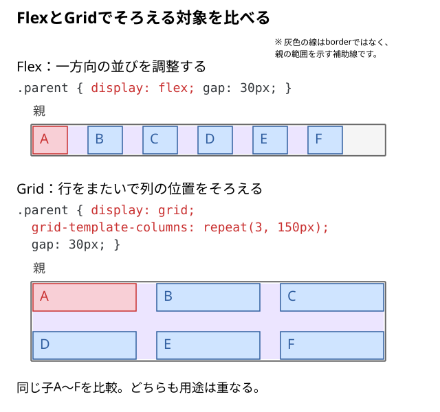

# Gridはどんなレイアウトで使う？

ナビゲーションを横に並べるときと、カードを同じ列幅で複数行に並べるときでは、どちらも「横並び」に見える。それでもFlexとGridを使い分けるのはなぜだろう？

## 結論：並ぶ方向を扱うならFlex、行と列の位置をそろえるならGrid

**Flex**は、基本的に「行または列」という**一方向**の中で、子要素の並びや空間の使い方を調整する仕組み。

**Grid**は、親が**列と行の枠（トラック）**を作り、その枠に子要素を配置する仕組み。同じ列に入るカードの左右位置を行をまたいでそろえたい場合に向いている。



> 図は仕組みの比較。Flexを使って複数行を作ることも、Gridを1列だけにすることもできる。「Flex＝横並び、Grid＝複数列」と覚えない。

## 同じHTMLで、親の指定だけを変えてみる

6個の要素を用意する。**配置指定を書くのは6個を直接包む親 `.parent`**。

```html
<div class="parent">
  <div class="child">A</div>
  <div class="child">B</div>
  <div class="child">C</div>
  <div class="child">D</div>
  <div class="child">E</div>
  <div class="child">F</div>
</div>
```

表示しやすいよう、子の色と行高だけを先に用意する。**このCSS自体はFlex/Gridの選択には関係しない。**

```css
.child {
  line-height: 40px;
  background: #cfe4ff;
}

.child:first-child {
  background: #f8cfd6;
}
```

### A｜まずFlexにすると？

```css
.parent {
  display: flex;
  gap: 30px;
}
```

- `.parent` の**直下の6個**がFlexアイテムになる。
- 初期状態では**横方向の1行**に並ぼうとする。
- `gap: 30px` はアイテム間の間隔を指定する。図の四角の輪郭は説明用で、Flexが自動的に枠線を描くわけではない。

子が多くて収まりきらない場合は、初期状態で自動的に次の行へ折り返すわけではない。折り返したいときは別途 `flex-wrap: wrap` が必要になる。

### B｜同じHTMLをGridにすると？

```css
.parent {
  display: grid;
  grid-template-columns: 150px 150px 150px;
  gap: 30px;
}
```

ここではまだ `fr` や `repeat()` を使わない。

- `display: grid` で親がGridコンテナになる。
- `grid-template-columns: 150px 150px 150px` で、**150pxの列を3本**作る。
- A〜Cが1行目、D〜Fが2行目へ入る。**行は自動で作られる。**
- 同じ列の位置・幅が上下の行でそろう。

`150px` は仕組みを比べるための仮の数値。親幅が狭い場合は列がはみ出す可能性がある。幅の配分とレスポンシブ化は03〜05の記事で扱う。

## 実装時の選び方

| 作りたいもの | 最初に試す方法 | 判断する理由 |
| --- | --- | --- |
| ナビゲーションのリンクを一列に並べる | Flex | 一方向の順番や間隔が中心 |
| 文字とアイコンを横に並べる | Flex | 小さな部品の一方向の整列 |
| 同じ幅のカードを3列×複数行で並べる | Grid | 行をまたいで列幅と位置をそろえる |
| メインとサイドバーの幅を列として決める | Grid | 親が複数列の寸法を管理する |
| 一列だけ・どちらでも実現できる | 必要な指定が少ない方 | 正解が一つに決まるとは限らない |

**HTMLの表データ**の行・列の関係は、見た目のためだけにGridへ置き換えず、`table` の役割として別に考える。

## DevToolsで確かめる

1. ブラウザでHTMLを開き、開発者ツール（DevTools）の **Elements** から `.parent` を選ぶ。
2. CSSの `display: flex` と `display: grid` を切り替え、**直下の子の並び**が変わることを確認する。
3. Gridのとき、`grid-template-columns` を `150px 150px` に変えてみる。**3列から2列**になり、残りの子は次の行へ配置される。
4. `.child` を選んでも `display: grid` が継承されているわけではないことを確認する。親のGridの中に**Gridアイテムとして参加**しているだけ。

### よくある取り違え

- **「Gridにしただけで3列になる」→ 違う。** `display: grid` だけでは、通常の自動配置は基本的に1列になる。列数を決める指定が別に必要。
- **「Flexは複数行にできない」→ 違う。** `flex-wrap` で折り返せる。ただし折り返した各行は基本的に独立して配置される。
- **「Gridなら子の文字や画像が自動で縮小する」→ 違う。** 列のサイズと子の内容の収まり方は別の問題。

## 確認したいことから読む

| 疑問 | 読む記事 | ここで分かること |
| --- | --- | --- |
| まず列を作りたい | [子要素を2列・3列に並べるには](./02_子要素を2列・3列に並べるには.md) | Gridにする・列を作る・間隔を空ける操作 |
| 幅を割合で配りたい | [frで列幅はどう決まる](./03_frで列幅はどう決まる.md) | gapを除いた幅と配分の重み |
| 等幅にならず横へ広がる | [1frなのに列が広がるのはなぜ](./04_1frなのに列が広がるのはなぜ.md) | 内容由来の最小幅とminmax |
| 親の幅に合わせて列数を変えたい | [列数を自動変更するには](./05_列数を自動変更するには.md) | auto-fitと最低列幅 |
| 子が少ないときの列幅を選びたい | [auto-fitとauto-fillの違い](./06_auto-fitとauto-fillの違い.md) | 空の列を折りたたむか残すか |
| 行の高さを決めたい | [行の高さはどう決まる](./07_行の高さはどう決まる.md) | 明示した行と追加された行の高さ |
| 子の位置や使う範囲を変えたい | [子要素を指定位置に配置するには](./08_子要素を指定位置に配置するには.md) | 行・列の指定、span、名前付き領域 |
| 枠の中で子を寄せたい | [子要素を上下左右に揃えるには](./09_子要素を上下左右に揃えるには.md) | 横・縦の整列とplace-items |
| 列に収まっても中身がはみ出す | [列幅と子要素のサイズの違い](./10_列幅と子要素のサイズの違い.md) | 列・子・文字や画像の担当 |
| 予想と違う行や列ができる | [Gridが想定どおりに並ばない原因](./11_Gridが想定どおりに並ばない原因.md) | 自動配置、追加トラック、観測からの確認 |

初めて実装するときは02から始める。全部の機能を覚えてから使い始める必要はない。入れ子をまたいで親の列・行を共有する必要が出たら、詳細の[subgrid](../../../../03_詳細/01_HTML・CSS/09_レイアウト/Grid/12_入れ子のGridで親子の列・行を揃えるには.md)へ進む。

列数・間隔・行高を組み合わせた完成例は、[カード一覧とカード内部の責務](../../15_UI部品の実装判断/06_カード一覧とカード内部の責務を分ける.md#親幅に合わせて列数が変わるカード一覧を作る)で確認できる。

## 仕様・確認先

- [MDN：CSSグリッドレイアウト](https://developer.mozilla.org/ja/docs/Web/CSS/Guides/Grid_layout)
- [MDN：フレックスボックスの基本概念](https://developer.mozilla.org/ja/docs/Web/CSS/Guides/Flexible_box_layout/Basic_concepts)
- [MDN：GridとFlexの関係（英語）](https://developer.mozilla.org/en-US/docs/Web/CSS/Guides/Flexible_box_layout/Relationship_with_other_layout_methods)
