# frで列幅はどう決まる？

2列に並べるところまではできた。しかし、`grid-template-columns: 1fr 2fr` と指定すると、列の幅は何を基準に決まるのだろう？ `1fr` は「親の半分」という意味なのだろうか？

## 結論：`fr` は、列に配分できる幅を比率で分ける

`fr` は Grid の**列・行のトラックへ配分する空間の割合**を表す単位。`1fr 2fr` なら、ほかの寸法や最小幅の制約がない場合、**分配対象の幅を1：2に分ける**。

親の幅そのものを単純に1：2にするのではない。まず `gap` や固定幅の列など、先に確保する部分を考える。



> 親幅は内容が入る部分の幅。図の比較は、短いA・Bが列の最小幅を押し広げない条件。

## 同じHTMLで、列の比率だけを変えてみる

変更するのは、**2個の子を直接包む親 `.parent` の `grid-template-columns`**。

```html
<div class="parent">
  <div class="child">A</div>
  <div class="child">B</div>
</div>
```

まず共通のCSSを用意する。

```css
.parent {
  display: grid;
  width: 510px;
  gap: 30px;
  grid-template-columns: 1fr 1fr;
}

.child {
  line-height: 40px;
  background: #cfe4ff;
}

.child:first-child {
  background: #f8cfd6;
}
```

親の内容幅510pxとgap30pxを保ち、列の比率だけを変えて比べる。

### A｜`1fr 1fr`：同じ割合

```css
.parent {
  grid-template-columns: 1fr 1fr;
}
```

- 分配する幅：`510px - 30px = 480px`
- `fr` の合計：`1 + 1 = 2`
- 1単位：`480px ÷ 2 = 240px`
- **左240px、右240px**

### B｜`1fr 2fr`：左1、右2

```css
.parent {
  grid-template-columns: 1fr 2fr;
}
```

- 分配する幅：`510px - 30px = 480px`
- `fr` の合計：`1 + 2 = 3`
- 1単位：`480px ÷ 3 = 160px`
- **左160px、右320px**

### C｜`2fr 1fr`：左右の割合を逆にする

```css
.parent {
  grid-template-columns: 2fr 1fr;
}
```

同じ480pxを2：1に分けるので、**左320px、右160px**になる。

このように、`fr` は列数を表す値ではない。**空間の配分比率**を指定する。

## `gap` を変えたらどうなる？

`grid-template-columns: 1fr 2fr` のまま、`gap: 60px` にすると、分配できる幅は `510 - 60 = 450px` になる。

計算上は左 `450 ÷ 3 = 150px`、右 `450 × 2 ÷ 3 = 300px`。**比率は変わらなくても、実際のpx幅は変わる**。

`gap` は列と列の間隔であり、`fr` の1単位には含まれない。

## 実装時の判断

| 作りたい幅の関係 | まず試す指定 | 結果 |
| --- | --- | --- |
| 同じ幅の2列 | `1fr 1fr` | 分配対象を1：1で分ける |
| メインをサイドの2倍にしたい | `2fr 1fr` | 分配対象を2：1で分ける |
| サイドをメインの2倍にしたい | `1fr 2fr` | 分配対象を1：2で分ける |
| 片方を150pxに固定したい | `150px 1fr` | 固定列を先に確保し、残りをもう一方へ配分する |

ここでの `fr` は**列トラックの幅**を決める。子要素の文字や画像そのものの寸法を縮小する指定ではない。

## 注意：`1fr 2fr` が必ず正確な1：2になるとは限らない

`1fr` は単独で書くと、列の**自動的な最小幅**を持つ（概念的には `minmax(auto, 1fr)`）。そのため、長くて改行できない文字列などがあると、内容の最小幅を優先して、図の計算どおりに縮まないことがある。

内容の最小幅と、列の下限を変える`minmax()`の関係は、[次の記事](./04_1frなのに列が広がるのはなぜ.md)で整理する。

## DevToolsで確かめる

1. 親 `.parent` を選び、`width: 510px` と `gap: 30px` が適用されていることを確認する。
2. `grid-template-columns` を `1fr 1fr` → `1fr 2fr` → `2fr 1fr` に切り替える。
3. Gridのオーバーレイで列の境界を表示し、それぞれの列が **240/240 → 160/320 → 320/160px** になることを確認する。
4. `gap` を60pxに変更する。列間の幅が先に増え、列の幅は小さくなる。
5. 片方に長くて改行できない文字列を入れ、比率どおりにならない場合があることも確認する。

### よくある取り違え

- **「`1fr` = 親幅の半分」→ 違う。** ほかの列の `fr` の合計、`gap`、固定幅、最小幅の制約によって決まる。
- **「`2fr` = `1fr` の200%の画面幅」→ 違う。** 同じGrid内の列トラック同士で使う比率。
- **「`1fr 2fr` は何が入っていても必ず1：2」→ 違う。** 自動的な最小幅が効く場合がある。
- **「列が160pxなら中の画像も160pxになる」→ 違う。** 列の大きさと中身のサイズ制御は分けて考える。

## 仕様・確認先

- [MDN：grid-template-columns](https://developer.mozilla.org/en-US/docs/Web/CSS/Reference/Properties/grid-template-columns)
- [MDN：minmax()](https://developer.mozilla.org/en-US/docs/Web/CSS/Reference/Values/minmax)
- [W3C：CSS Grid Layout Module Level 2](https://www.w3.org/TR/css-grid/)
