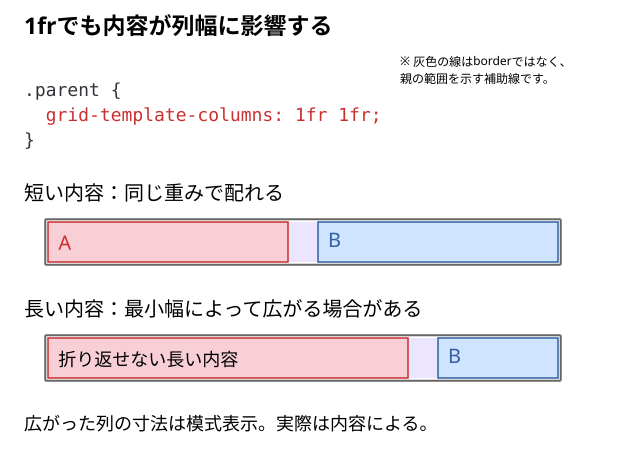

# 1frなのに列が広がるのはなぜ？

2列を同じ幅にするため `grid-template-columns: 1fr 1fr` を書いたのに、片方だけが大きくなることがある。なぜ `1fr` 同士なのに等幅にならないのだろう？

## 結論：中身の大きさが、列幅を決める最低条件になる場合がある

`1fr` には、子要素の内容を考慮する `auto` の最小値が含まれている。そのため、長くて途中で改行できない文字列などがあると、内容に押されて列が広がる場合がある。

`minmax(0, 1fr)` は、この `auto` を `0` に変更し、**中身の最小幅を列幅の最低条件にせず、Grid側の `fr` による配分を優先する**ための指定。

目的は列幅を0pxにすることではない。まず、もともとの `auto` が何をしているかを見てみよう。

## 1｜単独の `1fr` には、書かれていない `auto` が含まれる

通常の `1fr` は、実質的に次の指定として扱われる。

```css
.parent {
  grid-template-columns: 1fr 1fr;
}

/* 実質的に同じ */
.parent {
  grid-template-columns: minmax(auto, 1fr) minmax(auto, 1fr);
}
```

`minmax(最小値, 最大値)` は、列や行のサイズの範囲を指定する関数。この最小値が `auto` なので、**子要素の内容が必要とする幅が、列幅の決定に影響する場合がある**。

ここでの `auto` は、`grid-template-columns` プロパティそのものの初期値ではなく、単独の `1fr` に含まれる列の最小値を指す。影響する内容はインライン要素だけに限らず、画像なども含む。

`minmax()`はGridの列・行のトラック用で、`width`へ直接指定する関数ではない。`min()`・`max()`・`clamp()`との役割の違いは、[CSSのサイズ指定と関数](../../../../05_参照/CSSのサイズ指定と関数.md)で確認できる。

「最小幅を0にする」と聞くと目的が分からなくなる場合は、[0という値より先に何を理解すればよいのか](../../../../06_疑問/01_HTML・CSS/09_レイアウト/minmaxの0という値より先に何を理解すればよいのか.md)で、今回の疑問とGPTの説明を読める。

## 2｜`auto` によって、内容に押されて列が広がる

配置指定は2個の子を直接包む親 `.parent` に書く。

```html
<div class="parent">
  <div class="child">
    <span class="token">ABCDEFGHIJKLMNOPQRSTUVWXYZABCDEFGHIJKLMNOPQRSTUVWXYZABCDEFGHIJKLMNOPQRSTUVWXYZ</span>
  </div>
  <div class="child">B</div>
</div>
```

```css
.parent {
  display: grid;
  width: 510px;
  grid-template-columns: 1fr 1fr;
  gap: 30px;
}

.child {
  line-height: 40px;
  background: #cfe4ff;
}

.child:first-child {
  background: #f8cfd6;
}

.token {
  font-family: monospace;
}
```

この例の長い英字は、空白やハイフンなどの通常の改行位置がない**一続きの文字列**。折り返せないことで最小幅が大きくなりやすい。図の比較は、親幅510pxを確保できる環境を前提としている。

### A｜短い内容なら `1fr 1fr` で等幅になる

中身を短いテキストに変えると、次のように考えられる。

- 親の幅：510px
- 列間：30px
- 列に配分できる幅：480px
- **左240px、右240px**（内容が最小幅を押し広げない場合）

これは第03記事で扱った `fr` の配分と同じ。

### B｜長い内容では、`auto` の最小幅に押される

- 長い文字列の**途中に改行可能な位置がない**と、左列の内容由来の最小幅が大きくなりやすい。
- 左列がその幅より縮めず、**左240px／右240pxにならない**ことがある。
- 長すぎれば、列の合計幅と `gap` が親の510pxを超えることもある。

ここで起こるのは、まず**列トラックの幅が内容に影響される**という問題。

「内容の最小幅」が英単語・日本語・画像でどう変わるかは、[min-contentの具体例](../../../../05_参照/内容由来のサイズと自動最小サイズ.md#min-contentの具体例)で確認できる。子の自動最小幅が列へ影響する関係は、[列と子の最小幅を分ける](./10_列幅と子要素のサイズの違い.md#列と子の最小幅を分ける)で説明する。



自動最小幅は常に内容幅と同じになるわけではなく、子の `min-width` や `overflow`、列をまたぐ条件などにも左右される。図は仕組みの模式表示で、長い内容がある場合の正確な列幅は、文字・フォント・CSSによって変わる。

## 3｜`auto` を `0` に変え、内容による列の拡大を抑える

同じHTML・親幅・gapのまま、親の列指定だけを変える。

```css
.parent {
  grid-template-columns: repeat(2, minmax(0, 1fr));
}
```

変更しているのは、**列の最小値を `auto` から `0` にすること**。内容が必要とする最小幅を列幅の最低条件にしなくなる。`1fr` による配分はそのままなので、この例では親幅510pxからgap30pxを除いた480pxを分け、列はそれぞれ240pxになる。

`repeat(2, minmax(0, 1fr))` は `minmax(0, 1fr) minmax(0, 1fr)` と同じ意味。



## 4｜列幅の決定方法を変えても、中身は自動では収まらない

列が240pxになっても、長い文字列そのものを折り返したり縮小したりしたわけではない。そのため、**列は親に収まっているのに、文字は隣の列や親の外へはみ出す**ことがある。

つまり、**Gridの列幅を決める処理**と、**子要素の内容を列に収める処理**は別。文字を折り返すか、画像を縮めるかは、中身に合わせて決める。具体的な指定は[列幅と子要素のサイズの違い](./10_列幅と子要素のサイズの違い.md#列が収まっても文字は別に折り返す)で確認する。子へ指定する `min-width: 0` との違いも、同記事の[列と子の最小幅を分ける](./10_列幅と子要素のサイズの違い.md#列と子の最小幅を分ける)で扱う。

ここでの目的は、すべてのGridに `minmax(0, 1fr)` を機械的に付けることではない。列自体が広がっているのか、中身だけがはみ出しているのかを分けて確認する。症状から調べたい場合は[Gridが想定どおりに並ばない原因](./11_Gridが想定どおりに並ばない原因.md)へ進む。

`0` は列を0pxに固定する指定ではない。実際に配分できる幅がなくなる場合については、[可変列の幅が0になる条件](../../../../03_詳細/01_HTML・CSS/09_レイアウト/Grid/04_可変列の幅が0になる条件.md)で別に確認できる。

## DevToolsで確かめる

1. 上記HTMLを開き、`.parent` を選んでGridのオーバーレイを表示する。
2. `grid-template-columns: 1fr 1fr` の状態で、長い文字が入った列の境界を見る。必要ならComputedで計算後の列幅を確認する。
3. 同じ親幅・gap・内容のまま `repeat(2, minmax(0, 1fr))` に変更する。列が各240pxになったことと、文字ははみ出したままであることを別々に確認する。

## このページのまとめ

- 単独の `1fr` は、実質 `minmax(auto, 1fr)`。
- `auto` によって、子要素の内容が列幅の最低条件になる場合がある。
- `minmax(0, 1fr)` はその条件を外し、`fr` による列幅の配分を優先する。
- 列幅を決めることと、文字・画像を列に収めることは別。

## 仕様・確認先

- [W3C：CSS Grid Layout — Track Sizes](https://www.w3.org/TR/css-grid-2/#track-sizes)
- [W3C：CSS Grid Layout — Automatic Minimum Size of Grid Items](https://www.w3.org/TR/css-grid-2/#min-size-auto)
