# 列数を自動変更するには？

カードを3列で並べても、表示領域が狭いと1枚ずつが小さくなる。広いときは複数列、狭いときは少ない列へ、**毎回メディアクエリを書かずに切り替える**にはどうすればよいだろう？

## 結論：`repeat(auto-fit, minmax(150px, 1fr))` で列数を自動調整する

**親の `grid-template-columns` に `repeat(auto-fit, minmax(150px, 1fr))` を指定する。** 親の利用可能な幅に「最低150pxの列が何本入るか」を見て、入る本数だけ列を作る。各列は `1fr` によって残りの幅を分け合う。

```css
.parent {
  display: grid;
  grid-template-columns: repeat(auto-fit, minmax(150px, 1fr));
  gap: 30px;
}
```

> **重要：正確には「画面幅」ではなく「Gridコンテナが使える幅」で決まる。** 画面が広くても、狭いサイドバー内なら1列になることがある。図は親の内容幅を540px・390px・210pxへ変えた比較。

## 親の幅だけを変えて比べる

6個のカードを直接包む `.parent` にGridを設定する。

```html
<div class="parent">
  <div class="child">A</div>
  <div class="child">B</div>
  <div class="child">C</div>
  <div class="child">D</div>
  <div class="child">E</div>
  <div class="child">F</div>
</div>
```

```css
.parent {
  display: grid;
  grid-template-columns: repeat(auto-fit, minmax(150px, 1fr));
  gap: 30px;
}

.child {
  line-height: 40px;
  background: #cfe4ff;
}

.child:first-child {
  background: #f8cfd6;
}
```

子の色と行高は見分けるための補助指定。列へ配置する役割は親のGridが担う。

### A｜540pxなら3列になる

3列分の最低幅と隙間は以下のとおり。

```text
150px × 3列 + 30px × 2か所 = 510px
```

540pxに510pxが収まるため、3列が作れる。4列なら `150 × 4 + 30 × 3 = 690px` 必要なので入らない。

`1fr` によって残りも各列へ配られ、**各列は160px**になる。

```text
(540px - 30px × 2) ÷ 3 = 160px
```

子はA・B・Cが1行目、D・E・Fが2行目に入る。



### B｜390pxなら2列になる

2列なら `150 × 2 + 30 = 330px` で収まる。3列に必要な510pxはないため、**2列 × 3行**になる。

```text
(390px - 30px) ÷ 2 = 180px
```



### C｜210pxなら1列になる

2列に必要な330pxが入らないので、**1列 × 6行**になる。

```text
210px ÷ 1 = 210px
```

**`150px` は固定列幅ではなく最低幅**。必要な最低幅を確保したうえで、入る列数が決まり、`1fr` が余りの幅を配る。

## `auto-fit`・`minmax()`・`1fr` の担当は違う

| 書き方 | 役割 | この例で起こること |
| --- | --- | --- |
| `repeat(auto-fit, …)` | 幅に入る列の数を自動で決め、空の列を折りたたむ | 3列・2列・1列へ切り替わる |
| `minmax(150px, 1fr)` | 列幅を最低150px、上側は `1fr` で伸ばせるようにする | 160px、180px、210pxの列になる |
| `gap: 30px` | 列間・行間を30px空ける | 2列なら列間1か所、3列なら2か所 |

`repeat(3, minmax(0, 1fr))` と混同しない。こちらは**3列を固定して幅を均等配分する**指定であり、親が狭くなっても列数は自動で1列・2列へ減らない。`minmax(0, 1fr)` の「0」は列の下限、`minmax(150px, 1fr)` の「150px」は列の最低幅という違いもある。

子が少なくて空の列ができるときは、[auto-fitとauto-fillの違い](./06_auto-fitとauto-fillの違い.md)で、残りの列を広げるか空き列を残すかを選ぶ。

## 注意：親が150px未満になったら？

```css
grid-template-columns: repeat(auto-fit, minmax(150px, 1fr));
```

これは**最低150pxを維持する**指定。親のコンテンツ幅が120pxなどに狭まった場合、列が120pxまで自動的に縮むわけではなく、150pxの列が親から**はみ出す**ことがある。`auto-fit` に「最低幅そのものを下回る」という役割はない。

親より大きい最低幅を要求しない設計にしたいなら、次の方法もある。

```css
.parent {
  grid-template-columns:
    repeat(auto-fit, minmax(min(100%, 150px), 1fr));
}
```

`min(100%, 150px)` は、親の幅が150pxより狭いとき、その幅を下限として使うための指定。ただし**列幅を縮めることと、中身が縮むことは別問題**。長い文字列なら `overflow-wrap: anywhere`、画像なら `max-width: 100%; height: auto;` などを状況に応じて検討する（[列幅と子要素のサイズの違い](./10_列幅と子要素のサイズの違い.md)）。

## メディアクエリで列数を切り替える方法とは？

列数を**2列／3列のように明示して固定したい**場合は、メディアクエリを使う方法もある。

```css
.parent {
  display: grid;
  grid-template-columns: 1fr;
  gap: 30px;
}

@media (min-width: 720px) {
  .parent {
    grid-template-columns: repeat(3, minmax(0, 1fr));
  }
}
```

こちらは**ビューポート幅720px**を境に、1列と3列を明示的に切り替える。720pxは説明用の値で、実際はカードと親の大きさに合わせて判断する。**親の幅を基準に列数を自動計算する `auto-fit` とは判断の基準が違う**。

## 実装時の判断

| 作りたい配置 | まず検討する指定 | 判断する理由 |
| --- | --- | --- |
| 最低幅を保ち、入るだけカードを並べる | `repeat(auto-fit, minmax(150px, 1fr))` | 親の利用可能幅から列数を自動計算する |
| 子が少なくても空き列の幅を保持したい | `repeat(auto-fill, minmax(150px, 1fr))` | 空のトラックを残す |
| 画面幅の条件で厳密に列数を固定したい | `@media` ＋ `repeat(3, minmax(0, 1fr))` | 狙った条件で列数を明示できる |
| 最低幅150pxを確保できない親もあり得る | `minmax(min(100%, 150px), 1fr)` | 親より大きい最低幅を要求しない |

## DevToolsで確かめる

1. 上記の6個のHTMLを表示し、Elementsから**親 `.parent`** を選択してGridオーバーレイを表示する。
2. `.parent` を直接包む親などに幅を与えて調整し、Gridの**コンテンツ幅を540px → 390px → 210px**にする。3列 → 2列 → 1列に切り替わることを見る。
3. `gap` を `30px` → `60px` に変更する。**列数の判定には隙間も含まれる**ため、列が切り替わる幅も変化することを確認する。
4. 子を3個に減らしたときの違いは、06の空き列の比較で確認する。
5. 幅を120pxにして、`minmax(150px, 1fr)` の最低幅によるはみ出しを確認する。その後 `minmax(min(100%, 150px), 1fr)` を試す。

### よくある取り違え

- **「画面が540pxになったら必ず2列になる」→ 違う。** 基本的にはGridコンテナの利用可能幅で判定する。
- **「`auto-fit` は子の数を数えるだけ」→ 違う。** まず入る列数を親の幅から判定し、空き列があれば折りたたむ。
- **「`auto-fill` はカードの個数を増やす」→ 違う。** 作るのは空のGridトラック。HTMLの子要素は増えない。
- **「`minmax(150px, 1fr)` なら列幅は常に150px」→ 違う。** 150pxは下限で、余りがあれば伸びる。
- **「自動切替なら中身のはみ出しも解決する」→ 違う。** 列と子要素の収まり方は別に確認する。

## 仕様・確認先

- [MDN：grid-template-columns](https://developer.mozilla.org/en-US/docs/Web/CSS/Reference/Properties/grid-template-columns)
- [MDN：repeat()（auto-fitとauto-fill）](https://developer.mozilla.org/en-US/docs/Web/CSS/Reference/Values/repeat)
- [MDN：minmax()](https://developer.mozilla.org/en-US/docs/Web/CSS/Reference/Values/minmax)
