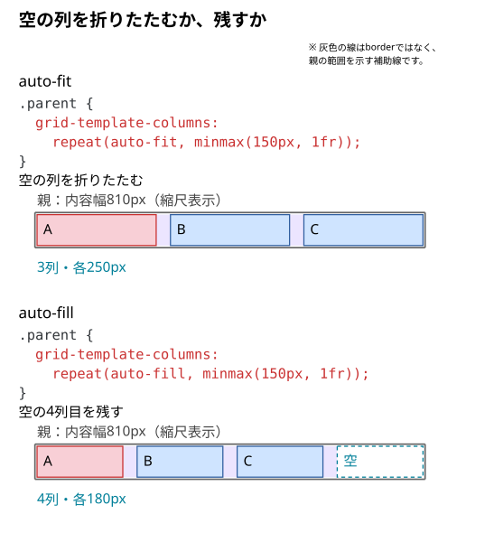

# auto-fitとauto-fillの違い

カードが列数分ある間は、auto-fitとauto-fillは同じ見た目になりやすい。では、**親に入る列の数よりカードが少ないとき、余った場所はどうなるのだろう？**

空の列を折りたたみ、残りのカードを広げるのがauto-fit。空の列も残すのがauto-fill。

## 同じ親幅・同じ3個の子で比べる

```html
<div class="parent">
  <div class="child">A</div>
  <div class="child">B</div>
  <div class="child">C</div>
</div>
```

```css
.parent {
  display: grid;
  width: 810px;
  grid-template-columns: repeat(auto-fit, minmax(150px, 1fr));
  gap: 30px;
}

.child {
  line-height: 40px;
  background: #cfe4ff;
}

/* Aを見分けるための色分け */
.child:first-child {
  background: #f8cfd6;
}
```

親の内容幅810pxには、最低150pxの列が4本入る。必要幅は`150 × 4 + 30 × 3 = 690px`。5本には`870px`必要なので入らない。



図の空の4列目は、子の箱とは別にシアンの破線で示している。

## auto-fitは空の列と隣接するgapを折りたたむ

子が使う3列へ幅が配られ、各列は`(810 - 30 × 2) ÷ 3 = 250px`になる。残った子を広げて空間を使いたい一覧で選ぶ。

## auto-fillは空の列も幅の配分に残す

列指定の`auto-fit`だけを`auto-fill`へ置き換える。

```css
.parent {
  grid-template-columns: repeat(auto-fill, minmax(150px, 1fr));
}
```

4列の枠が残り、各列は`(810 - 30 × 3) ÷ 4 = 180px`になる。4列目に子が増えるわけではない。子が少なくても空き列の幅を残したい場合に選ぶ。

どちらも、最初に入る列数を幅から求める点は同じ。auto-fitは配置後に空いた列を折りたたむ。列をまたぐ子がある場合、その子が使う列を空列として数えない。

DevToolsで列指定だけを切り替え、空の列と子の列幅を確認する。子を4個にすると、同じ幅でどちらも4列を使い、見た目の差がなくなる。

## 一言でいうと

子が少ないときに残りの子を広げるならauto-fit、空の列を残すならauto-fillを選ぶ。

仕様確認先：[CSS Grid Layout Module Level 2](https://www.w3.org/TR/css-grid-2/#auto-repeat)。
