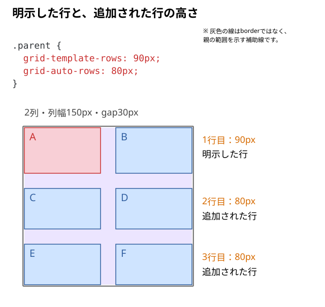
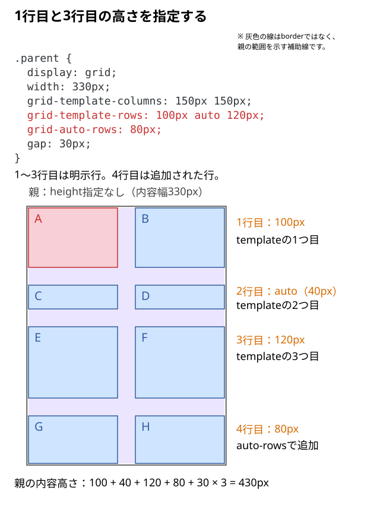

# 行の高さはどう決まる？

Gridでは、親全体の高さを指定しなくても、子要素を配置するための行を作れる。

例えば、2列のGridに子要素を6個並べると、1行に2個ずつ配置されるため、3行が必要になる。

この3行の高さを決める方法には、**あらかじめ行を定義する方法**と、**必要になった行の高さを指定する方法**がある。

```css
.parent {
  display: grid;
  width: 330px;
  grid-template-columns: 150px 150px;
  grid-template-rows: 90px;
  grid-auto-rows: 80px;
  gap: 30px;
}
```

`grid-template-rows: 90px` は、最初の1行を高さ90pxとして定義する。

一方、2行目と3行目は、残りの子要素を配置するために自動で追加される。この追加された行には `grid-auto-rows: 80px` が適用される。

つまり、2つの指定は優先順位で競合しているわけではなく、**明示した行と自動追加された行を、それぞれ担当している**。



また、今回は親の `height` を指定していない。この例のように外側から高さを固定されず、padding・borderもない場合、行の高さと行間を合計した310pxが親の内容高さになる。

`90px + 80px + 80px + 30px × 2 = 310px`

このように、**行の数・各行の高さ・親全体の高さは、別々のものとして考える**。

Gridの列・行を一つずつ帯状に見た領域を**トラック**と呼ぶ。ここで高さを決めているのは、行トラック。

## 同じHTMLと補助CSSを用意する

上の例では、次の6個の子を並べている。以降もこの構造を使い、子を増やすときや内容を変えるときは、その箇所で示す。

```html
<div class="parent">
  <div class="child">A</div>
  <div class="child">B</div>
  <div class="child">C</div>
  <div class="child">D</div>
  <div class="child">E</div>
  <div class="child">F</div>
</div>
```

```css
.child {
  line-height: 40px;
  background: #cfe4ff;
}

.child:first-child {
  background: #f8cfd6;
}
```

子の`line-height`と背景色は、行の高さや箱を見やすくするための共通CSS。

## 1行目と3行目の高さを指定する

1行目を100px、3行目を120pxにして、2行目は内容に合わせたい場合はどう書くのだろう？

`grid-template-rows`へ、1行目から順に`100px auto 120px`と書く。間の2行目も、`auto`という値で明示する。

Fは短い1行のままにし、親の末尾へG・Hを追加して8個の子にする。子の`line-height: 40px`は前の例と共通。

```html
<div class="child">G</div>
<div class="child">H</div>
```

```css
.parent {
  display: grid;
  width: 330px;
  grid-template-columns: 150px 150px;
  grid-template-rows: 100px auto 120px;
  grid-auto-rows: 80px;
  gap: 30px;
}
```



**2行目の`auto`も、`grid-template-rows`で定義した明示行。** `grid-auto-rows`の担当にはならない。8個の子を2列に並べるために必要になった4行目が、`grid-auto-rows: 80px`の担当になる。どちらかが強いのではなく、適用する行が違う。

この例では親の`height`を指定せず、padding・borderもない。親の内容高さは、4行の高さと3か所の行間を足した`100 + 40 + 120 + 80 + 30 × 3 = 430px`になる。

## 内容に合わせる行と、固定した行を比べる

ここからはG・Hを外して、最初のA〜Fの6個へ戻す。Fだけを3行にして、行高の指定だけを変える。

```html
<div class="parent">
  <div class="child">A</div>
  <div class="child">B</div>
  <div class="child">C</div>
  <div class="child">D</div>
  <div class="child">E</div>
  <div class="child">F<br>続き<br>続き</div>
</div>
```

親のCSSも次へ置き換え、前の`grid-template-rows`と`grid-auto-rows`をいったん外す。子の補助CSSはそのまま使う。

```css
.parent {
  display: grid;
  width: 330px;
  grid-template-columns: 150px 150px;
  gap: 30px;
}
```

この例では行を明示していないため、3行とも`grid-auto-rows`の対象になる。`grid-auto-rows`を省略した場合の初期値は`auto`。次から、この値だけを切り替えて比べる。

### A｜文章に合わせて行を伸ばす（`auto`）

```css
.parent {
  grid-auto-rows: auto;
}
```

この例は1行が40pxなので、短い内容の1・2行目は40px、Fがある3行目は120pxになる。

行の高さは、その行にある子要素の内容に必要な高さなどを基準に決まる。**同じ行にある子は同じ行トラックを使う**ため、Fの文章が多ければ3行目全体が高くなる。行ごとの高さが同じになるとは限らない。

ここでの `auto` は「常に内容の高さぴったり」の意味ではない。Gridコンテナに余分な高さがあり、`align-content: stretch` が働く場合などは、自動サイズの行へ余白が配られることがある。

### B｜常に80pxに固定する（`80px`）

```css
.parent {
  grid-auto-rows: 80px;
}
```

作られた行トラックは80pxの高さになる。Fの内容が多くても、**行が文章に合わせて自動で伸びるとは限らない**。内容がはみ出したり、ほかの行へ重なって見えたりする可能性がある。

「行の高さを固定すること」と「中の内容を収めること」は別。`overflow` や文章の省略、カード内レイアウトの方針も必要になる。



### C｜最低80pxにして、必要なら伸ばす（`minmax()`）

```css
.parent {
  grid-auto-rows: minmax(80px, auto);
}
```

各行はまず**最低80px**を確保する。80pxで足りない行は、通常その内容に応じて大きくなる。カードの最低高さをそろえつつ、文章が増えたら行を伸ばしたいときに向く。

`minmax()` は**行トラック**のサイズを決める関数。子要素のフォントサイズ、行数、画像の大きさを変更するものではない。



## `1fr` を行の高さに使うと？

行を明示していない一覧では、次の指定も使える。

```css
.parent {
  grid-auto-rows: 1fr;
}
```

`fr` は列幅だけでなく行高にも使える。しかし、**親の高さが明示されているかどうか**で結果が変わる。

親に `height: 420px` のような確定した高さがあり、内容の最小サイズなどの制約が許せば、行は利用可能な高さを分け合う。一方、親の高さが `auto` で内容から決まる場合、`1fr` は単純に「画面の高さを均等に割る」という意味ではない。複数の `1fr` 行が、必要なサイズを基準に同じ高さになることもある。

また、`1fr` は最小サイズの制約も関係する。**常に好きな高さまで縮ませられるわけではない**。この点は第03・04記事で説明した列の `fr` と共通する。

## 行の高さと、行の中の子の位置は別

`align-items`や`align-self`は、行そのものの高さではなく、行の中で子をどう置くかを変える。行が90pxあっても、子を上へ寄せることはできる。[子要素の上下左右の揃え方](./09_子要素を上下左右に揃えるには.md)で比べる。

## DevToolsで確かめる

1. 最初の6個の子で親のGridオーバーレイを表示し、1行目が90px、2・3行目が80pxになっているかを見る。
2. `grid-auto-rows`を外し、明示した1行目を保ったまま、追加行が内容に合わせた高さへ変わるかを見る。
3. G・Hを追加した例で、2行目の`auto`が明示行、4行目が追加行であることを確かめる。`grid-auto-rows`を変えたとき、どの行へ効くかを見る。
4. A〜Fの6個へ戻してFだけを3行にし、親の行指定を外す。`auto`・固定80px・`minmax(80px, auto)`を切り替え、**行の境界**と**文字のはみ出し**を比べる。

## このページのまとめ

- 明示した行だけでは子を配置できない場合、必要な行が追加される。明示行はgrid-template-rows、追加行はgrid-auto-rowsで高さを決める。
- grid-template-rowsのautoも明示行。autoという値だけで、追加行かどうかは決まらない。
- 親の高さを指定しない今回の例では、行の高さと行間の合計が親の内容高さになる。
- autoは内容に応じて決まり、固定高は内容が増えても伸びない。
- minmax(80px, auto)の80pxは下限。内容が多い行は伸ばせる。
- 行の高さを決める指定と、行内の子の位置を決める指定は分けて考える。

仕様確認先：[MDN：grid-auto-rows](https://developer.mozilla.org/en-US/docs/Web/CSS/Reference/Properties/grid-auto-rows)、[CSS Grid Layout Module Level 2](https://www.w3.org/TR/css-grid-2/#fr-unit)。
