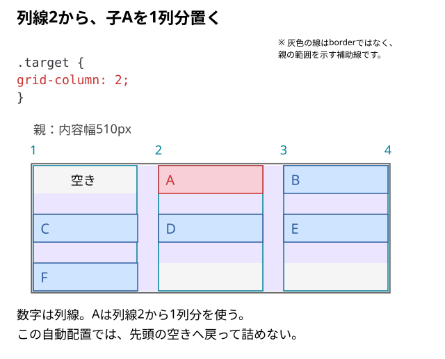
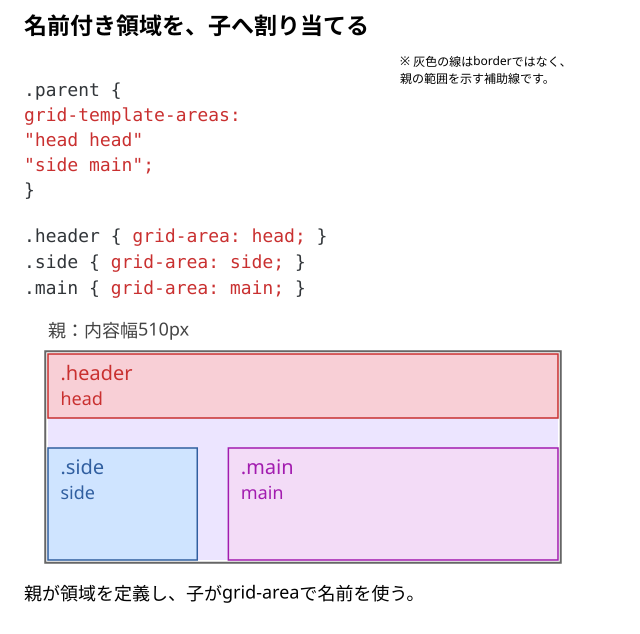

# 子要素を指定位置に配置するには？

カードを2列目へ置きたい。一つの見出しに2列分を使わせたい。**親が作った枠のどこへ子を置くかは、何で指定するのだろう？**

列や行を作るのは親、どこからどこまで使うかを指定するのは子。 `grid-column`・`grid-row`で位置や範囲を選び、`span`で使うトラック数を指定する。

## 親の列と、指定する子を用意する

```html
<div class="parent">
  <div class="child target">A</div>
  <div class="child">B</div>
  <div class="child">C</div>
  <div class="child">D</div>
  <div class="child">E</div>
  <div class="child">F</div>
</div>
```

```css
.parent {
  display: grid;
  width: 510px;
  grid-template-columns: repeat(3, 150px);
  gap: 30px;
}

.child {
  line-height: 40px;
  background: #cfe4ff;
}

/* Aを見分けるための色分け */
.child:first-child {
  background: #f8cfd6;
}
```

子Aに`target`も付け、配置を変える対象にする。列や行の境界を**グリッド線**と呼ぶ。通常の横書き・左から右のこの例では、3列の列線は左から1〜4で数える。

## 子Aを2列目へ置く

親の列指定を保ち、子へ次を書く。

```css
.target {
  grid-column: 2;
}
```

子Aは2番の列線から1列分を使い、この例では`grid-column: 2 / 3`とも書ける。親が用意した2列目へ置く指定。`grid-row: 2`なら、同じように2行目を指定する。



この例の通常の自動配置は`grid-auto-flow: row`。Aの配置先から先へ進むので、後のB〜Fは1行目の左端の空きへ戻って詰めない。数字は列線の番号を示す。空きを埋める指定との違いは[自動配置の確認](./11_Gridが想定どおりに並ばない原因.md#空きがあっても次の子が入るとは限らない)へつなぐ。

## 子Aに2列分を使わせる

Aの`grid-column: 2`を外して最初の配置へ戻し、今度はAへ2列分を使わせる。

```css
.target {
  grid-column: 1 / span 2;
}
```



`1 / span 2`は、列線1から2列分を使う指定。`1 / 3`とも書ける。Aが横に使う幅は、2列とその間のgapを合わせた`150 × 2 + 30 = 330px`になる。

縦にも2行分使うなら、子へ`grid-row: 1 / span 2`を追加する。行の高さをどう作るかは[行高の記事](./07_行の高さはどう決まる.md)で決める。

## 名前で領域を割り当てる

ヘッダー、サイド、メインなどの領域を名前で指定するなら、親へ`grid-template-areas`を書く。以下は、先ほどの6個の子とは別の構造を使う例。

```html
<div class="parent">
  <header class="header">見出し</header>
  <aside class="side">補足</aside>
  <main class="main">本文</main>
</div>
```

```css
.parent {
  display: grid;
  width: 510px;
  grid-template-columns: 150px minmax(0, 1fr);
  grid-template-areas:
    "head head"
    "side main";
  gap: 30px;
}

.header { grid-area: head; }
.side { grid-area: side; }
.main { grid-area: main; }
```

各引用符が1行、その中の名前が各列に対応する。`head`は横に2列を使う。親が名前付き領域を定義し、子の`grid-area`がその名前を使う。名前はクラス名と自動対応するものではない。



図では、headが横に2列、sideとmainがその下の1列ずつを使う。行高は模式表示。

同じ名前の領域は一つの長方形にする。空けておくセルは`.`で表せる。

## 見た目とHTMLの順番を分けて確認する

CSSの配置を変えても、DOM順、読み上げ順、キーボード移動順が同じように変わるとは限らない。意味上の順番をHTMLで保ち、そのうえで配置を割り当てる。

見た目を合わせるために意味や操作順が不自然になるなら、先にHTML構造を見直す。[意味からHTML要素を選ぶ](../../04_HTMLの意味と構造/01_意味からHTML要素を選ぶ.md)考え方へ戻る。

DevToolsのGrid表示で列線・行線と子の範囲を見る。子の配置指定を無効にして自動配置と比べ、狭い幅での読み順と操作順も確認する。予想と違う空きや追加列ができたら[自動配置の確認](./11_Gridが想定どおりに並ばない原因.md)へ進む。

親のトラックを入れ子の子と共有したい場合は、詳細の[subgrid](../../../../03_詳細/01_HTML・CSS/09_レイアウト/Grid/12_入れ子のGridで親子の列・行を揃えるには.md)を使う。

## このページのまとめ

- 親が列・行を定義し、子が使う位置と範囲を選ぶ。
- spanは使うトラック数。間にあるgapも範囲へ含まれる。
- 名前付き領域では親の定義と子のgrid-areaを対応させる。
- 見た目を変えても、HTMLの読み順と操作順は別に確認する。

仕様確認先：[CSS Grid Layout Module Level 2](https://www.w3.org/TR/css-grid-2/#placement)、[MDN：grid-template-areas](https://developer.mozilla.org/en-US/docs/Web/CSS/Reference/Properties/grid-template-areas)。
