# 子要素を上下左右に揃えるには？

Gridで列や行は作れた。次に、**枠の中で子を中央や端へ寄せるには、どこへ何を書けばよいだろう？**

横に寄せるならjustify-items、縦に寄せるならalign-itemsを親へ書く。このページでは通常の横書き・左から右の配置で比べる。

## 子より大きいセルを用意する

列と行が交わる一つの枠を**セル**と呼ぶ。セルいっぱいへ広がる子では位置の差が見えにくいため、ここでは子の幅・高さを小さく指定する。

```html
<div class="parent">
  <div class="child">A</div>
  <div class="child">B</div>
  <div class="child">C</div>
  <div class="child">D</div>
</div>
```

```css
.parent {
  display: grid;
  width: 330px;
  grid-template-columns: 150px 150px;
  grid-template-rows: 90px 90px;
  gap: 30px;
  justify-items: start;
  align-items: start;
}

.child {
  line-height: 30px;
  background: #cfe4ff;
}

/* Aを見分けるための色分け */
.child:first-child {
  background: #f8cfd6;
}

.child {
  width: 70px;
  height: 30px;
}
```

セルは幅150px・高さ90px、子は幅70px・高さ30px。比較中の親幅も、2列とgapの合計330pxへそろえる。背景色と行高は見分けるための補助指定。

## 横だけ中央へ寄せる

`align-items: start`を保ち、`justify-items`だけを変える。

```css
.parent {
  justify-items: center;
}
```



子の左右に`(150 - 70) ÷ 2 = 40px`ずつ残る。列の位置や列幅は変わらない。

## 次に縦も中央へ寄せる

横中央の指定を残し、`align-items`だけを変える。

```css
.parent {
  align-items: center;
}
```



上下には`(90 - 30) ÷ 2 = 30px`ずつ残る。

| 値 | この例での横方向 | この例での縦方向 |
| --- | --- | --- |
| start | 左端 | 上端 |
| center | 中央 | 中央 |
| end | 右端 | 下端 |

## 両方向をまとめて指定する

`place-items`は`align-items`と`justify-items`をまとめる省略形。

```css
.parent {
  place-items: center;
}
```

1個の値なら両方向へ使う。2個なら`place-items: align-itemsの値 justify-itemsの値`の順。例えば`place-items: center start`は、この横書きの例では縦中央・横左端になる。

一つの子だけ変えるなら、その子へ`justify-self`・`align-self`、または`place-self`を書く。

## 中央にならないときに見る対象

親のGrid表示でセルの範囲、子のBox Modelで子の寸法を見る。子がセルを埋めているなら、移動できる空間はない。幅・高さがautoの通常の子は、既定の揃え方で枠へ広がることがあるため、[列幅と子の寸法](./10_列幅と子要素のサイズの違い.md)を分けて確認する。

ここで動かすのはセル内の子の箱。`justify-content`・`align-content`は、親の余りの中でトラック全体を揃える別の指定になる。また、子の箱を寄せても、中の文字そのものを中央へ寄せる指定にはならない。

## このページのまとめ

- この横書きの例ではjustify-itemsが横、align-itemsが縦を担当する。
- place-itemsで両方向をまとめられる。
- 子の位置と、子の中の文字の位置、トラック全体の位置は区別する。

仕様確認先：[CSS Grid Layout Module Level 2](https://www.w3.org/TR/css-grid-2/#alignment)、[MDN：justify-items](https://developer.mozilla.org/en-US/docs/Web/CSS/Reference/Properties/justify-items)。
