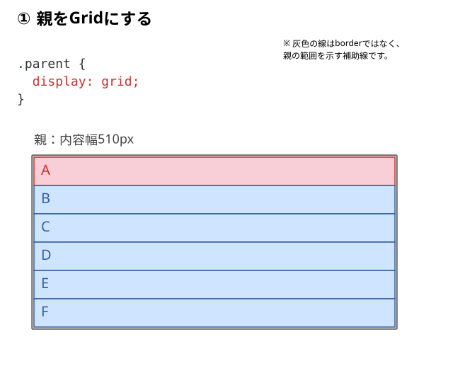

# 子要素を2列・3列に並べるには？

6個のカードをGridで並べたい。2列にすれば3行、3列にすれば2行になるはずだが、**何を指定すると列の本数が決まり、カード間の隙間はどこで作る**のだろう？

親をGridにしてから列を作り、gapで間隔を加える。同じHTMLで一つずつ試してみる。

## 同じHTMLと補助CSSを用意する

```html
<div class="parent">
  <div class="child">A</div>
  <div class="child">B</div>
  <div class="child">C</div>
  <div class="child">D</div>
  <div class="child">E</div>
  <div class="child">F</div>
</div>
```

```text
parent  ← Gridの指定を書く親
├─ child A
├─ child B
├─ child C
├─ child D
├─ child E
└─ child F
```

親の幅は510pxでそろえる。子の背景色とline-heightは、箱を見分けやすくするための共通CSS。

```css
.parent {
  width: 510px;
  background: #f5f5f5;
}

.child {
  line-height: 40px;
  background: #cfe4ff;
}

/* Aを見分けるための色分け */
.child:first-child {
  background: #f8cfd6;
}
```

以下では共通CSSを残し、親へ指定を追加していく。図の色や枠線は説明用。

## ① 親をGridにする

親へ新しく加える指定は`display: grid`だけ。

```css
.parent {
  display: grid;
}
```



この親が**Gridコンテナ**、通常フローにある直下の子が**Gridアイテム**になる。`display: grid`だけでは、この通常の自動配置で子が複数列へ並ぶわけではない。この例では1列になる。

## ② 列を2本にする

①に`grid-template-columns`だけを追加する。

```css
.parent {
  display: grid;
  grid-template-columns: 150px 150px;
}
```



`150px 150px`は、幅150pxの列を2本作る指定。A・Bが1行目、C・Dが2行目、E・Fが3行目に入る。必要な行は自動で追加される。

列は縦に続く領域、行は横に並ぶ領域。この段階では`fr`も`minmax()`も必要ない。親の右側に幅が余っても、指定した列幅は150pxのまま。

## ③ 列と行の間を空ける

②に`gap`だけを追加する。

```css
.parent {
  display: grid;
  grid-template-columns: 150px 150px;
  gap: 30px;
}
```



列幅を変えずに、列間と行間の両方へ30pxのすき間ができる。図の薄紫の帯がgap。`gap`は親の外周へ余白を作らない。

横の列間だけを変えるなら`column-gap`、縦の行間だけなら`row-gap`を使う。`gap: 30px`は両方へ同じ値を指定する書き方。

2列なら列間は1か所。横に使う幅は`150 × 2 + 30 = 330px`で、残りの180pxは右側に残る。外周の余白が必要なら、[gap・margin・paddingの指定先](../12_gapとmarginとpaddingを使い分ける.md)を分ける。

## ④ 同じ幅の列を3本にする

③の列指定へ、3本目の`150px`を追加する。gapなど他の条件は変えない。

```css
.parent {
  display: grid;
  grid-template-columns: 150px 150px 150px;
  gap: 30px;
}
```



3列では列間が2か所になる。`150 × 3 + 30 × 2 = 510px`となり、この例では親の内容幅と一致する。

同じ指定を繰り返すなら、列の値だけを`repeat(3, 150px)`へ置き換えられる。これは同じ3列を作る書き方なので、表示は変わらない。

```css
.parent {
  display: grid;
  grid-template-columns: repeat(3, 150px);
  gap: 30px;
}
```

`repeat()`の3は固定の繰り返し回数。親が狭くなっても列数や列幅は自動では減らず、510pxを確保できなければはみ出す場合がある。列幅を配分する方法は[frの記事](./03_frで列幅はどう決まる.md)、列数を変える方法は[自動列数の記事](./05_列数を自動変更するには.md)で扱う。

## 行間と列間を別々にする

③の2列の例へ戻り、列幅と列間を保って、行間だけを広げる。

```css
.parent {
  display: grid;
  grid-template-columns: 150px 150px;
  gap: 50px 30px;
}
```



`gap`を2値で書く順番は**行間 → 列間**。`gap: 50px 30px`は、`row-gap: 50px; column-gap: 30px;`と同じ結果になる。`row-gap`が空けるのはGridの行トラック間で、文章の行間ではない。

横の列幅を計算するときに差し引くのは列間30px。行間50pxを引くわけではない。子にmarginがある場合や、余った空間を整列指定で配分する場合は、見た目の子同士の距離にその分も加わる。

## 指定と結果を確かめる

親をDevToolsで選び、①〜④を順に試す。①では1列、②では2列で間隔なし、③では列幅を保って列間・行間が30px、④では3列2行になるかを見る。最後に列の値だけを`repeat()`へ変え、結果が同じか確認する。親幅を510pxより狭くした場合に、固定した列が自動で縮まないことも試す。

## このページのまとめ

- `display: grid`で親をGridコンテナにする。
- `grid-template-columns`へ書いた列指定が列の本数と幅を決める。
- `gap`は列間・行間に入り、親の外周には入らない。
- `repeat(3, ...)`は同じ列指定を繰り返す。列数の自動変更とは異なる。

仕様確認先：[CSS Grid Layout Module Level 2](https://www.w3.org/TR/css-grid-2/#track-sizing)、[CSS Grid Layout Module Level 2](https://www.w3.org/TR/css-grid-2/#gutters)。
