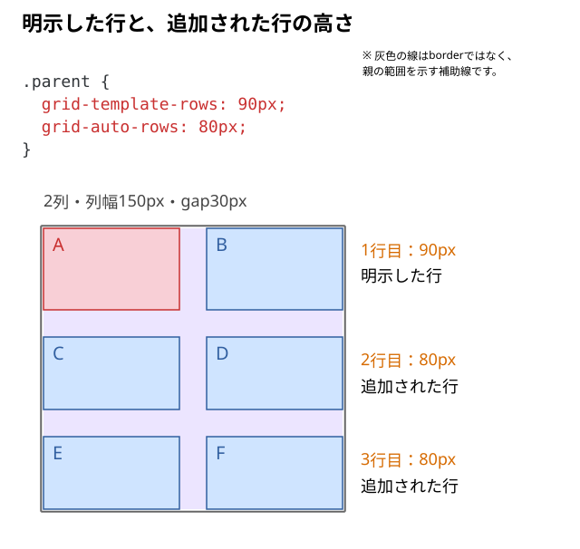

# 行の高さはどう決まる？

カードの文章が増えたら行も伸ばしたい。短いカードにも最低限の高さを確保したい。**Gridの行トラックの高さは、何で決めればよいだろう？**

## 結論：追加される行はgrid-auto-rows、明示する行はgrid-template-rows

| 指定 | 対象 | 使う場面 |
| --- | --- | --- |
| `grid-auto-rows` | 自動で作られる行 | カードが増えて行数が変わる一覧 |
| `grid-template-rows` | 明示的に定義する行 | 最初の行など、決めた行を設計するとき |

行を対象にする指定と、その指定へ書く高さの値を分けて考える。内容に合わせるなら`auto`、固定するなら`80px`、最低80pxを確保して伸ばすなら`minmax(80px, auto)`を使う。

## 内容に合わせる行と、固定した行を比べる

6個の子を同じ2列へ並べる。Fだけを3行にして、行高の指定だけを変える。

```html
<div class="parent">
  <div class="child">A</div>
  <div class="child">B</div>
  <div class="child">C</div>
  <div class="child">D</div>
  <div class="child">E</div>
  <div class="child">F<br>続き<br>続き</div>
</div>
```

```css
.parent {
  display: grid;
  width: 330px;
  grid-template-columns: 150px 150px;
  gap: 30px;
}

.child {
  line-height: 40px;
  background: #cfe4ff;
}

.child:first-child {
  background: #f8cfd6;
}
```

親の高さは指定していない。子のline-heightと背景色は、行の高さや箱を見やすくするための共通CSS。

### A｜文章に合わせて行を伸ばす（`auto`）

```css
.parent {
  grid-auto-rows: auto;
}
```

この例は1行が40pxなので、短い内容の1・2行目は40px、Fがある3行目は120pxになる。

行の高さは、その行にある子要素の内容に必要な高さなどを基準に決まる。**同じ行にある子は同じ行トラックを使う**ため、Fの文章が多ければ3行目全体が高くなる。行ごとの高さが同じになるとは限らない。

ここでの `auto` は「常に内容の高さぴったり」の意味ではない。Gridコンテナに余分な高さがあり、`align-content: stretch` が働く場合などは、自動サイズの行へ余白が配られることがある。

### B｜常に80pxに固定する（`80px`）

```css
.parent {
  grid-auto-rows: 80px;
}
```

作られた行トラックは80pxの高さになる。Fの内容が多くても、**行が文章に合わせて自動で伸びるとは限らない**。内容がはみ出したり、ほかの行へ重なって見えたりする可能性がある。

「行の高さを固定すること」と「中の内容を収めること」は別。`overflow` や文章の省略、カード内レイアウトの方針も必要になる。



### C｜最低80pxにして、必要なら伸ばす（`minmax()`）

```css
.parent {
  grid-auto-rows: minmax(80px, auto);
}
```

各行はまず**最低80px**を確保する。80pxで足りない行は、通常その内容に応じて大きくなる。カードの最低高さをそろえつつ、文章が増えたら行を伸ばしたいときに向く。

`minmax()` は**行トラック**のサイズを決める関数。子要素のフォントサイズ、行数、画像の大きさを変更するものではない。



## 最初の行だけ高さを指定する

ここからはFも短い1行の内容へ戻す。親のCSSを次へ置き換え、最初の行だけ90pxへ指定する。

```css
.parent {
  display: grid;
  width: 330px;
  grid-template-columns: 150px 150px;
  grid-template-rows: 90px;
  gap: 30px;
}
```

明示した1行目は90px。2・3行目は子を配置するために追加され、まだ内容に応じた高さになる。列・行を一つずつ帯状に見た領域を**トラック**と呼ぶ。

## 追加される行の高さもそろえる

前の指定へ`grid-auto-rows`だけを追加する。

```css
.parent {
  display: grid;
  width: 330px;
  grid-template-columns: 150px 150px;
  grid-template-rows: 90px;
  grid-auto-rows: 80px;
  gap: 30px;
}
```



`grid-auto-rows`は、すでに`grid-template-rows`で定義した行の高さを上書きしない。この例では2・3行目へ適用される。子を増やして4行目ができた場合も80pxになる。

## `1fr` を行の高さに使うと？

行を明示していない一覧では、次の指定も使える。

```css
.parent {
  grid-auto-rows: 1fr;
}
```

`fr` は列幅だけでなく行高にも使える。しかし、**親の高さが明示されているかどうか**で結果が変わる。

親に `height: 420px` のような確定した高さがあり、内容の最小サイズなどの制約が許せば、行は利用可能な高さを分け合う。一方、親の高さが `auto` で内容から決まる場合、`1fr` は単純に「画面の高さを均等に割る」という意味ではない。複数の `1fr` 行が、必要なサイズを基準に同じ高さになることもある。

また、`1fr` は最小サイズの制約も関係する。**常に好きな高さまで縮ませられるわけではない**。この点は第03・04記事で説明した列の `fr` と共通する。

## 行の高さと、行の中の子の位置は別

`align-items`や`align-self`は、行そのものの高さではなく、行の中で子をどう置くかを変える。行が90pxあっても、子を上へ寄せることはできる。[子要素の上下左右の揃え方](./09_子要素を上下左右に揃えるには.md)で比べる。

## DevToolsで確かめる

1. Fだけを3行にしたHTMLで、親のGridオーバーレイを表示する。
2. `auto`・固定80px・`minmax(80px, auto)`を切り替え、**行の境界**と**文字のはみ出し**を比べる。
3. Fを短く戻し、最初の行を90px、追加行を80pxにする。`grid-template-rows`と`grid-auto-rows`が、どの行へ効くかを見る。
4. 子を増やし、追加行の高さも80pxになることを確認する。

## このページのまとめ

- 自動で追加される行の高さはgrid-auto-rows、明示する行はgrid-template-rowsで決める。
- autoは内容に応じて決まり、固定高は内容が増えても伸びない。
- minmax(80px, auto)の80pxは下限。内容が多い行は伸ばせる。
- 行の高さを決める指定と、行内の子の位置を決める指定は分けて考える。

仕様確認先：[MDN：grid-auto-rows](https://developer.mozilla.org/en-US/docs/Web/CSS/Reference/Properties/grid-auto-rows)、[CSS Grid Layout Module Level 2](https://www.w3.org/TR/css-grid-2/#fr-unit)。
