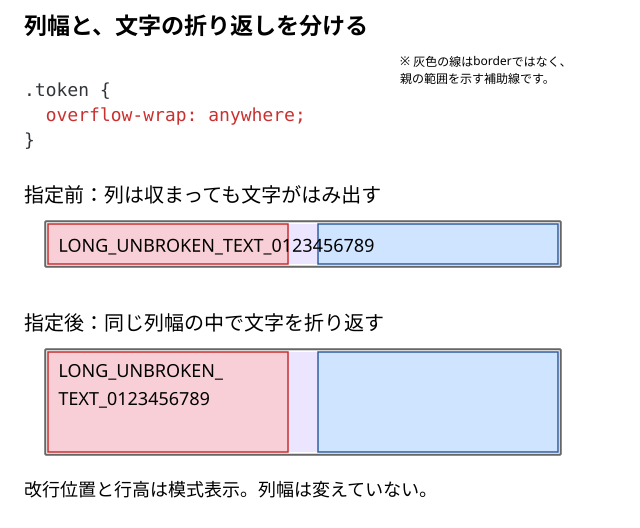

# 列幅と子要素のサイズの違い

列は150pxあるのに、子の箱は70pxしかない。列は親に収まったのに、文字だけがはみ出す。**列の幅と、子や中身の大きさはどう違うのだろう？**

列は親が作る枠、子はその枠へ配置される要素。列の幅、子の幅、子の中の文字・画像の表示は、同じ寸法になるとは限らない。

## 列を保ち、子の幅だけを変える

以下は2列・2行を持つ親。子の幅を70pxにして、列幅150pxとの差を見る。

```html
<div class="parent">
  <div class="child">A</div>
  <div class="child">B</div>
  <div class="child">C</div>
  <div class="child">D</div>
</div>
```

```css
.parent {
  display: grid;
  width: 330px;
  grid-template-columns: 150px 150px;
  grid-template-rows: 90px 90px;
  gap: 30px;
}

.child {
  line-height: 30px;
  background: #cfe4ff;
}

/* Aを見分けるための色分け */
.child:first-child {
  background: #f8cfd6;
}

.child {
  width: 70px;
  height: 30px;
}
```



この例で子の`width`だけを無効にすると、通常の`div`は既定のストレッチで列幅まで広がる。親幅330pxと列幅150pxは保つ。図のシアンは列の枠、色付きの箱は子。列と行の交わりがセルであり、子の外枠と同じものではない。

高さも枠へ合わせたいなら子の`height`を外す。行高を内容に任せたいなら、親の`grid-template-rows`も別に判断する。画像のように固有の寸法・比率を持つ要素や、別の揃え方を指定した子が常に同じように広がるわけではない。

## 列と子の最小幅を分ける

| 指定・確認先 | 変更する対象 |
| --- | --- |
| 親のgrid-template-columns、minmax | 列トラックのサイズ |
| 子のwidth、min-width、揃え方 | 子の寸法と枠内の位置 |
| 文字の折り返し、画像の寸法、overflow | 子の内部の表示 |

Gridコンテナの直接の子要素を**Gridアイテム**と呼ぶ。列や行のトラックは配置するための領域、アイテムはそこへ配置される要素。アイテム内の画像や文字は、さらにその中の内容になる。

```text
.parent：Gridコンテナ（列・行のトラックを定義する）
└─ .child：Gridアイテム（直接の子）
   └─ imgや文字：内部コンテンツ
```

Gridアイテムの`min-width`の初期値は`auto`。条件によって、内容から決まる自動最小幅を使う。親の単独の`1fr`にも、列の最小値として`auto`が含まれている。

| 対象 | 指定 | 役割 |
| --- | --- | --- |
| 親が作る列 | `minmax(auto, 1fr)` | 子の最小幅を考慮して列の最小幅を決める |
| Gridアイテム | `min-width: auto` | 条件によって内容に基づく子の最小幅を決める |

たとえば、自然幅340pxの画像を含む子を考える。ここでは子の幅を固定せず、子は`overflow: visible`で単独の`1fr`の列を1本だけ使う。画像にも別の幅・高さ・最大幅の制約を加えない。

1. 子の`min-width: auto`が、画像の幅340pxを内容由来の最小幅として扱う。
2. 列の`auto`が、その子の最小幅を考慮する。
3. 結果として、列幅が340px以上になる場合がある。

つまり、**子要素の最小幅 → Gridの列の最小幅 → 実際の列幅**という関係がある。これはサイズへの影響をたどる見方で、ブラウザ内部の計算順序を固定するものではない。内容由来の幅を表す`min-content`などの用語は、[内容由来のサイズと自動最小サイズ](../../../../05_参照/内容由来のサイズと自動最小サイズ.md)で確認できる。

自動最小幅は、常に画像の自然幅や`min-content`になるわけではない。子の`overflow`や列をまたぐ条件、別の寸法指定によって変わる。

### どちらの最小幅を変更するか

`minmax(0, 1fr)`は親の列トラックの下限を0へ変える。`min-width: 0`は子自身の自動最小幅を0まで許可する。似た結果になる場合もあるが、変更する対象が違う。

子が内容幅を最小幅として要求している場合は、04の長い文字の例で、親の`1fr 1fr`を保って子へ次の指定を加えた結果も比べられる。

```css
.child {
  min-width: 0;
}
```

これは親の列指定を変える比較とは分け、子の最小幅だけを変える例。列が収まっても、長い文字を折り返す指定にはならない。列の境界と子の実寸から、どこで最小幅が残っているかを確認する。親の列指定を変える比較は[1frの記事](./04_1frなのに列が広がるのはなぜ.md)にある。

## 列が収まっても文字は別に折り返す

長い一続きの文字を折り返してよいなら、その文字を含む要素へ書く。

```css
.token {
  overflow-wrap: anywhere;
}
```



04で使った長い文字のHTMLを、列を`minmax(0, 1fr)`にした状態で比べる。変えるのは文字の折り返しだけ。

`white-space: nowrap`などで一行を保つ必要があるなら、省略やスクロールなど別の表示方法を選ぶ。`overflow: hidden`で切り取っても内容が収まる寸法へ変わるわけではない。

## 画像なら画像自身の寸法を調整する

子の中の内容画像を、子の幅以内で比率を保って表示する例。

```css
.child img {
  max-width: 100%;
  height: auto;
}
```

これは画像の最大幅を親の内容幅以内へ制限する指定。列幅を決める指定ではない。画像を自然幅より広げるかどうかで選ぶ`width: 100%`との違いは、[画像の幅を親いっぱいにするか、上限だけにするか](../../12_レスポンシブ画像設計/02_画像全体を自然比率で表示する.md#widthとmax-widthを使い分ける)で確認する。固定幅の子があるなら、その幅を維持すべきかも判断する。一つの箱の寸法を追うときは[箱の大きさの確認順](../../05_ボックスとdisplay/12_箱の大きさが予想と違うときの確認順.md)へ戻る。

DevToolsでは、列の境界、子のBox Model、中の文字・画像の順に対象を分けて見る。入れ子の孫は、外側の親Gridへ直接並ぶ子ではない。[外側と内側のレイアウト](../04_親子のレイアウト文脈を区別する.md)も区別する。

## このページのまとめ

- 列の枠と子の寸法は別。子が列いっぱいになるには条件がある。
- 子の自動最小幅が、列のautoへ影響する場合がある。
- minmaxは列、min-widthは子の最小幅を変える。
- 列や子の縮小と、文字・画像をどう表示するかは別々に決める。

仕様確認先：[CSS Grid Layout Module Level 2](https://www.w3.org/TR/css-grid-2/#grid-item-sizing)、[CSS Grid Layout Module Level 2](https://www.w3.org/TR/css-grid-2/#min-size-auto)。
