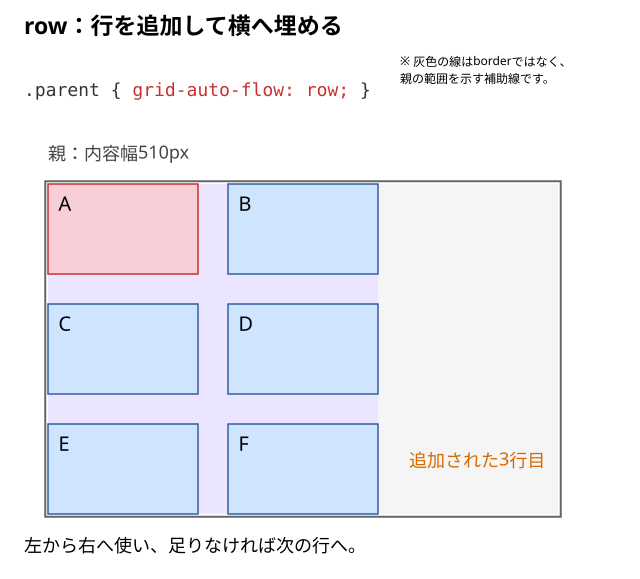
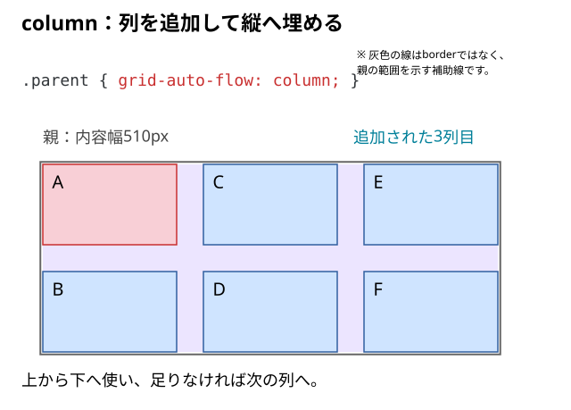
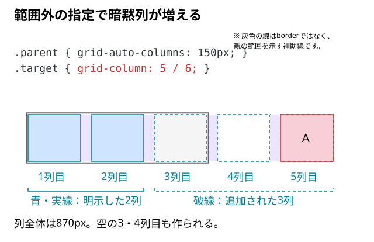

# Gridが想定どおりに並ばない原因

3列にしたつもりが1列になる。列の幅がそろわない。子が予想外の位置へ移動する。**見た目が崩れたとき、どのCSSから確認すれば原因を絞れるだろう？**

## 結論：親 → 列トラック → 子の配置 → 中身 → 余白の順に調べる

Gridの問題を一度に直そうとせず、**列の枠そのものが違うのか、枠は正常で子や中身だけが違うのか**を先に区別する。

最初はChrome DevToolsの**Elementsで親のGridコンテナ**を選ぶ。`grid` バッジまたはLayoutパネルのGridオーバーレイを使えば、列と行の境界を見られる。

## 「並ばない」を観測できる形にする

| 画面で起きていること | 最初の確認先 | 関連する説明 |
| --- | --- | --- |
| 1列にしかならない | 親のdisplayと列指定、直下の子 | [列を作る](./02_子要素を2列・3列に並べるには.md) |
| 3列のつもりが2列になる | 親幅、最低列幅、gap | [自動列数](./05_列数を自動変更するには.md) |
| 1列だけ広くなる・横へあふれる | 列の最小幅、子と中身の幅 | [列の下限](./04_1frなのに列が広がるのはなぜ.md)と[子の寸法](./10_列幅と子要素のサイズの違い.md) |
| 子の順番・位置が予想と違う | grid-column・grid-row・order・grid-auto-flow | [配置範囲](./08_子要素を指定位置に配置するには.md) |
| 高さ・上下位置だけが違う | 行高、子の内容、揃え方 | [行高](./07_行の高さはどう決まる.md)と[整列](./09_子要素を上下左右に揃えるには.md) |
| 余白が広い・狭い | gap、padding、子のmargin | [余白の担当](../12_gapとmarginとpaddingを使い分ける.md) |

## 例①｜Gridにしたのに1列のまま

```html
<div class="parent">
  <div class="child">A</div>
  <div class="child">B</div>
  <div class="child">C</div>
</div>
```

```css
.parent {
  display: grid;
  gap: 30px;
}
```

`display: grid` **だけでは3列を作らない**。列の指定がなければ、この例の自動配置は通常1列になる。3列を作るなら、親へ次を追加する。

```css
.parent {
  grid-template-columns: repeat(3, minmax(0, 1fr));
}
```

それでも変わらなければ、**StylesでそのCSSが適用されているか**、対象の3つの `.child` が本当に `.parent` の**直下の子**かを確認する。途中に別のラッパーがあれば、Gridが直接配置するのはそのラッパーになる。

> `repeat(3, …)` は列数固定。親が狭くなっても自動では2列や1列にならない。列数を自動切替したい場合は第05記事の `auto-fit` を使う。

## 例②｜`1fr` なのに列幅がそろわない・はみ出す

次は**トラックの境界**を確認する。`1fr` は無条件に「内容を無視して半分ずつ」という意味ではなく、内容の最小幅が列の大きさへ影響することがある。

[04の長い文字のHTML](./04_1frなのに列が広がるのはなぜ.md)を使い、親の列指定を比べる。

```css
.parent {
  display: grid;
  grid-template-columns: 1fr 1fr;
  gap: 30px;
}
```

例えば子に長いURLや改行できない文字列があると、列が想定以上に大きくなる場合がある。まず、**列トラックの最小幅**を0にした場合と比べる。

```css
.parent {
  grid-template-columns: repeat(2, minmax(0, 1fr));
}
```

これで**列自体がそろっても、中の文字がはみ出す**なら別の指定が必要。必要に応じて子の最小幅と内容の折り返しを確認する。

```css
.child {
  min-width: 0;
}

.token {
  overflow-wrap: anywhere;
}

.child img {
  max-width: 100%;
  height: auto;
}
```

`minmax(0, 1fr)` は**列トラック**の下限、`min-width: 0` は**子の箱**の下限、`overflow-wrap` は**文字の折り返し**を扱う。それぞれの担当を混同しない（[列幅と子要素のサイズの違い](./10_列幅と子要素のサイズの違い.md)）。

## 空きがあっても、次の子が入るとは限らない

Gridの直下の子は、基本的に自動配置される。ただし、一部の子に `grid-column` や `grid-row` があると、ほかの子も配置位置が変わる。

```css
.parent {
  display: grid;
  grid-template-columns: repeat(3, minmax(0, 1fr));
  gap: 30px;
}

.child:nth-child(1),
.child:nth-child(2) {
  grid-column: span 2;
}
```

3列のうちAが2列分を占めると、残りは1列分。Bも2列分必要なのでその場所には入らず、**次の行へ送られる**。1行目の3列目が空いて見えても、Gridが壊れたわけではない。

位置が予想と違う場合は、子に指定された `grid-column`・`grid-row`・`grid-area`、さらに `order` と親の `grid-auto-flow` を確認する。`grid-auto-flow: dense` で空きを埋める方法もあるが、**視覚的な順番がHTMLの順番と違う可能性**があるため、先に配置指定が必要か判断する。

## 指定した枠と、追加される枠がある

`grid-template-columns`や`grid-template-rows`で定義した部分を**明示的Grid**と呼ぶ。そこへ収まらない子や、範囲外への配置指定のために追加される部分が**暗黙的Grid**になる。

ここからは子の配置指定を外し、次のHTML・CSSへ置き換える。2列・2行を明示した親へ6個の子を入れる。

```html
<div class="parent">
  <div class="child">A</div>
  <div class="child">B</div>
  <div class="child">C</div>
  <div class="child">D</div>
  <div class="child">E</div>
  <div class="child">F</div>
</div>
```

```css
.parent {
  display: grid;
  width: 510px;
  grid-template-columns: 150px 150px;
  grid-template-rows: 90px 90px;
  grid-auto-columns: 150px;
  grid-auto-rows: 90px;
  grid-auto-flow: row;
  gap: 30px;
}

.child {
  line-height: 40px;
  background: #cfe4ff;
}

/* Aを見分けるための色分け */
.child:first-child {
  background: #f8cfd6;
}
```

自動追加される行・列の幅と高さもそろえ、ここでは配置方向の違いだけを見る。`grid-auto-rows`の担当は[行高の記事](./07_行の高さはどう決まる.md)で確認できる。

## 自動配置の方向を比べる

通常の自動配置は`grid-auto-flow: row`。この横書きの例では、左から右へ列を使い、足りなくなると次の行へ進む。子E・Fのために3行目が追加される。



親の指定を保ち、次の値だけを変える。

```css
.parent {
  grid-auto-flow: column;
}
```



`column`では、この例の2行を上から下へ使い、次の列へ進む。E・Fのために3列目が追加される。子の数はどちらも6個で、HTMLの順番は変わらない。追加された行・列とA〜Fの順番を見比べる。

## 子が少なくても、範囲外の指定で列が増える

別の最小例として、子をAだけにする。親は2列を明示し、Aの配置先だけを5列目へ指定する。

```html
<div class="parent">
  <div class="target">A</div>
</div>
```

```css
.parent {
  display: grid;
  width: 510px;
  grid-template-columns: 150px 150px;
  grid-auto-columns: 150px;
  gap: 30px;
}

.target {
  grid-column: 5 / 6;
}
```



`5 / 6`は5番と6番の列線の間。3〜5列目が必要になるため、子が入らない3・4列目も作られる。全5列と4か所のgapで`150 × 5 + 30 × 4 = 870px`となり、親の510pxを超える。列を作る必要がなくなれば、暗黙列も残り続けるわけではない。Aの配置指定を無効にした結果と比べる。

`grid-auto-columns`・`grid-auto-rows`は、必要になった暗黙列・行の**大きさ**を決める。指定した本数の列や行を作る命令ではない。

## DevToolsで切り分ける手順

1. **親を選ぶ。** Elementsで `.parent` を選び、Stylesで `display: grid` と `grid-template-columns` が有効か確認する。
2. **線を見る。** `grid` バッジをクリックするかLayoutのGridオーバーレイを有効にし、列数・列境界・実際のトラック幅を確認する。
3. **幅を確認する。** 親のコンテンツ幅と `gap` を確かめる。`auto-fit` の場合、最低幅と隙間の合計が収まるか計算する。
4. **子の指定を見る。** 予想外の位置にある `.child` を選び、`grid-column` / `grid-row` / `order` を一時的に無効にして違いを見る。
5. **はみ出しの発生元を見る。** トラック自体が親を超えているのか、トラック内の文字や画像だけが超えているのかを調べる。
6. **見た目の距離を見る。** 列が正常なら、最後に `gap`、`padding`、`margin`、`align-*` を確認する。

変更は一度に1つだけ。**CSSの指定を無効化 → 図のどこが変化したか確認 → 必要なら戻す**、という順にすると原因を特定しやすい。

### よくある取り違え

- **「`display: grid` だけで3列になる」→ 違う。** 列を明示する必要がある。
- **「`auto-fit` の列数は画面幅だけで決まる」→ 違う。** Gridコンテナの利用可能幅と `gap`・最低幅で決まる。
- **「列幅が正しければ中身も必ず収まる」→ 違う。** 子の最小幅や文章・画像の収まりは別。
- **「HTMLの順序なら見た目も必ず同じ順序になる」→ 違う。** 明示配置・`order`・`dense` などによって変わり得る。
- **「行の高さが違うのは `gap` のせい」→ 限らない。** 内容量と `grid-auto-rows`、整列なども確認する。

## 仕様・確認先

- [Chrome for Developers：Gridレイアウトを検証する](https://developer.chrome.com/docs/devtools/css/grid/)
- [MDN：グリッドの自動配置](https://developer.mozilla.org/ja/docs/Web/CSS/Guides/Grid_layout/Auto-placement)
- [MDN：grid-auto-flow](https://developer.mozilla.org/en-US/docs/Web/CSS/Reference/Properties/grid-auto-flow)
- [MDN：grid-template-columns](https://developer.mozilla.org/en-US/docs/Web/CSS/Reference/Properties/grid-template-columns)
