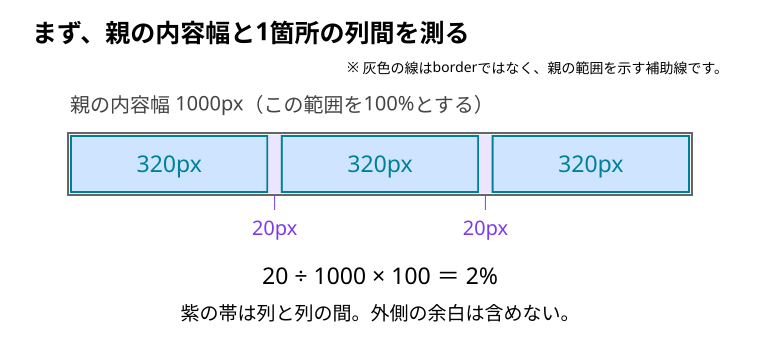
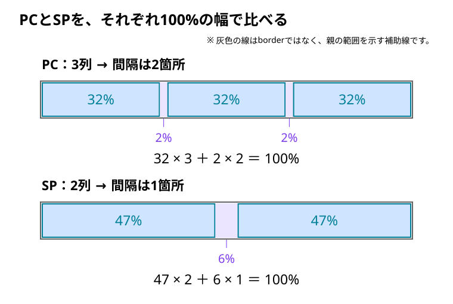
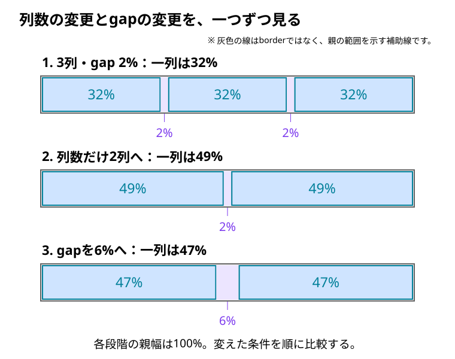

# カンプからcolumn-gapの割合を決める

Figmaで列の幅や横の間隔は測れた。でも、CSSの `column-gap` には何%と書けばよいのだろう？ PCとSPで列数が違うときは、同じ値を使ってよいのだろう？

**列間を親の幅に合わせて伸縮させたいなら、「1箇所の列間 ÷ 親の内容幅 × 100」で割合を求める。** そのうえで、列幅と列間を合わせて親の幅に収まるか確認する。

割合指定が必須というわけではない。間隔を一定に保ちたいならpx、ルート要素の文字サイズを基準にしたいならremも選べる。カンプで寸法を読めることと、画面幅が変わったときの動かし方を決めることは分けて考える。

ここでは、PCで3列、SPで2列にする一般例を使う。数値は計算用の仮定であり、特定のカンプの実測値や著者の採用値ではない。

## 1. どの幅を100%にするか確認する

まず、カンプで次の三つを確認する。

- **親の内容幅**：列と列間を並べる領域の横幅。
- **列幅**：同じ幅で並ぶ一列分の横幅。
- **列間**：隣り合う列の端から端までの距離。

画面全体の幅を、そのまま100%の基準にしない。外側の余白や親のpaddingがあれば、それを除いた、実装で列を並べる範囲を基準にする。Figmaの親フレームとCSSの親の内容領域が対応しているかを先に確かめる。

以下は、親の内容幅が1000px、列幅が320px、列間が20pxだったと仮定した例。



```text
1箇所の列間：20px ÷ 1000px × 100 ＝ 2%
一列の幅　 ：320px ÷ 1000px × 100 ＝ 32%
```

この場合は `column-gap: 2%` が候補になる。

ただし、見えている間隔がすべてCSSのgapとは限らない。子のmarginや `justify-content: space-between` などで空きが加わることもある。再現したい列の境界をそろえて測り、実装後も同じ場所を比較する。測定対象の違いは[カンプとブラウザで測る場所をそろえる](../01_HTML・CSS/07_ブラウザ挙動と表示のズレ/03_カンプとブラウザで測る場所をそろえる.md)で確認できる。

## 2. 3列なら、残りの幅を2箇所の間隔へ分ける

ここからは、**等しい幅の列と、等しい間隔だけで親の内容幅を使い切る**場合を考える。追加の左右余白や、列間へ加わるmarginは含めない。

一列が32%で3列なら、列が使う幅は次のとおり。

```text
列が使う幅：32% × 3列 ＝ 96%
残った幅　：100% − 96% ＝ 4%
```

**3列の「間」は2箇所。** 残った4%を、その2箇所へ等しく分ける。

```text
1箇所のgap：4% ÷ 2 ＝ 2%
```

これで、カンプの列間から求めた2%と、列幅の残りから求めた2%が一致する。列の数で割るのではなく、**間隔の数で割る**のがポイント。

## 3. SPで2列にするなら、その条件で計算する

SPでは一列を47%にしたいと仮定する。2列の間隔は1箇所なので、残った幅がそのまま1箇所のgapになる。

```text
列が使う幅：47% × 2列 ＝ 94%
残った幅　：100% − 94% ＝ 6%
1箇所のgap：6% ÷ 1 ＝ 6%
```



図は**それぞれの親幅を100%にそろえた割合の比較**。実際のPC画面とSP画面を、同じpx幅で表示するという意味ではない。

### 列数が変わったら、gapの割合も必ず変える？

必ず変える必要はない。2列でもgapを2%のままにするなら、列幅は次のようになる。

```text
列に使える幅：100% − 2% ＝ 98%
一列の幅　　：98% ÷ 2 ＝ 49%
```

つまり、**「2列だからgapを6%にする」と決まるわけではない。** SPのカンプで必要な列幅・間隔を確認し、その関係に合う値を選ぶ。



割合が同じでも、親の内容幅が変わればgapの実寸は変わる。たとえば2%なら、親幅600pxで12px、親幅400pxで8pxになる。%の大小だけで、PCとSPの実際の間隔の広さは判断しない。

列数を変えて計算したいときや、整数%になる候補の規則が気になったときは、[列幅とgapの一般式と整数パーセントの条件](../../03_詳細/01_HTML・CSS/09_レイアウト/Grid/13_列幅とgapの一般式と整数パーセントの条件.md)へ進める。ここまでの具体的な計算だけでも、この例は実装できる。

## 4. 決めた割合をGridへ書く

同じ要素を、PCでは3列、SPでは2列へ並べる。配置の指定は、子を直接包む親 `.parent` に書く。

```html
<div class="parent">
  <div class="child">A</div>
  <div class="child">B</div>
  <div class="child">C</div>
  <div class="child">D</div>
  <div class="child">E</div>
  <div class="child">F</div>
</div>
```

```css
/* PC：3列 */
.parent {
  display: grid;
  grid-template-columns: repeat(3, minmax(0, 1fr));
  column-gap: 2%;
}

/* SP：2列。800pxは動作を試すための仮の境界 */
@media screen and (max-width: 800px) {
  .parent {
    grid-template-columns: repeat(2, minmax(0, 1fr));
    column-gap: 6%;
  }
}
```

Gridでは、gapを除いた残りの幅を、同じ `1fr` の列へ等しく分ける。したがって、この指定ならPCの一列は32%相当、SPの一列は47%相当になり、子へその割合のwidthを書く必要はない。配分の仕組みは[frで列幅はどう決まる](../01_HTML・CSS/09_レイアウト/04_Grid/03_frで列幅はどう決まる.md)、`minmax(0, 1fr)` の目的は[1frなのに列が広がるのはなぜ](../01_HTML・CSS/09_レイアウト/04_Grid/04_1frなのに列が広がるのはなぜ.md)へつながる。

この例は横方向だけを扱う。縦の間隔が必要なら `row-gap` を別に決める。

ブレークポイントは、カンプの画面幅やこの仮の数値をそのまま採用せず、[配置が成立する幅で決める](../01_HTML・CSS/09_レイアウト/05_配置が成立する幅でブレークポイントを決める.md)。列幅の計算はGridが行うが、その幅で文字や画像が収まるかは別に確認する。

## 5. 読み取れたことと、推測を分ける

| 種類 | 何が言えるか |
| --- | --- |
| カンプから読み取れること | そのカンプでの列数、列幅、列間、基準にした領域の幅。実際のレイヤーを測って確認する |
| 計算で確かめられること | 測った幅に対する割合、列とgapの合計、列数を変えた後の列幅 |
| 著者の意図についての推測 | 切りのよい値を選んだ、PCに近い割合をSPで使った、といった採用理由。著者の説明がなければ確定しない |

たとえば「PCとSPのgapが違うのは、列幅を整数%にしたかったからかもしれない」とは考えられる。ただし、計算が合うことだけでは、その理由を選んだ証明にはならない。一枚のカンプだけで、間隔を固定したいのか、親幅に比例させたいのかまで決めつけない。

## 6. カンプの幅と、その間の幅で確認する

1. カンプと同じ画面幅にし、親の内容幅・列幅・列間を同じ境界で比較する。
2. PC側とSP側で、それぞれ列数とgapの指定が切り替わるか確認する。
3. 境界の直前・直後と中間の幅で、文字や画像のはみ出し、間隔の窮屈さを確認する。
4. 合わないときは測定範囲を見直し、割合指定を続けるか、px・remなどで間隔を保つか判断する。

## このページのまとめ

- 割合は「1箇所の列間 ÷ 親の内容幅 × 100」で求める。
- 3列の間隔は2箇所、2列の間隔は1箇所。残った幅を間隔の数で割る。
- 列数を変えたら列幅とgapの関係を確認する。gapの割合を変更するかはデザイン上の判断。
- 計算の一致と、著者がその値を選んだ理由は分ける。
- 最後はカンプとの比較と、中間幅での表示を確認する。

## 仕様・確認先

- [W3C：gapの割合の基準](https://www.w3.org/TR/css-gaps-1/#percentages)
- [W3C：Gridのfrによる幅の配分](https://www.w3.org/TR/css-grid-2/#fr-unit)
