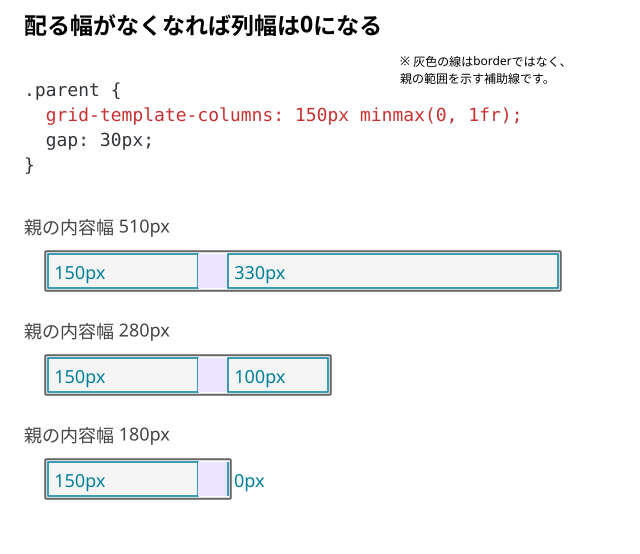

# 可変列の幅が0になる条件

元の記事：[1frなのに列が広がるのはなぜ？](../../../../02_基礎/01_HTML・CSS/09_レイアウト/Grid/04_1frなのに列が広がるのはなぜ.md)

`minmax(0, 1fr)` は、列幅を0pxに固定する指定ではない。では、実際に列幅が0pxになるのはどんなときだろう？

## 列幅が本当に0になる条件

固定列とgapで幅を使い切ると、可変列へ配る幅はなくなる。空の子を二つ使い、内容由来の制約をなくして比べる。

```html
<div class="parent">
  <div></div>
  <div></div>
</div>
```

```css
.parent {
  display: grid;
  width: 510px;
  grid-template-columns: 150px minmax(0, 1fr);
  gap: 30px;
}
```



図の高さは模式表示。比較するのは列幅だけ。

| 親の内容幅 | 可変列に残る幅 |
| --- | --- |
| 510px | `510 - 150 - 30 = 330px` |
| 280px | `280 - 150 - 30 = 100px` |
| 180px | `180 - 150 - 30 = 0px` |

親をさらに狭めても、可変列は負の幅にはならない。固定列とgapが親からあふれるため、必要なら[配置が成立する幅で切り替える](../../../../02_基礎/01_HTML・CSS/09_レイアウト/11_配置が成立する幅でブレークポイントを決める.md)。

## 一言でいうと

この例では、固定列とgapを除いた残り幅がなくなると、可変列の幅が0pxになる。
