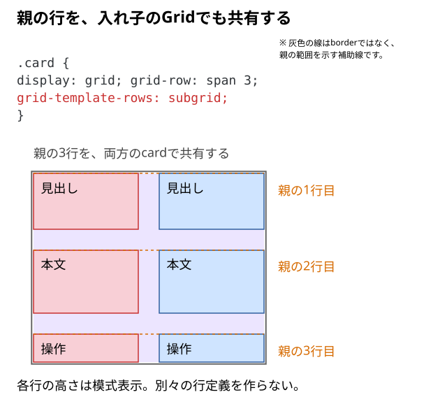

# 入れ子のGridで親子の列・行を揃えるには

**入れ子のGridで親のトラックを使いたい場合は、共有する軸へ`subgrid`を指定する。** 主な基礎は[子要素の位置と範囲の指定](../../../../02_基礎/01_HTML・CSS/09_レイアウト/04_Grid/08_子要素を指定位置に配置するには.md)。

## 通常の入れ子Gridとの違い

子を`display: grid`にしただけでは、内側の行・列は基本的に独立する。隣り合うカードの見出し、本文、操作の行位置をそろえたいとき、親の行を共有するsubgridを検討する。

```text
parent  ← 2列と3行を作る
├─ card A  ← 親の3行分を使い、行を共有
│  ├─ 見出し
│  ├─ 本文
│  └─ 操作
└─ card B  ← 同じ親の3行を共有
   ├─ 見出し
   ├─ 本文
   └─ 操作
```

## 親が作った3行を子でも使う

```html
<div class="parent">
  <div class="card">
    <div>見出しA</div>
    <div>短い本文</div>
    <div>操作A</div>
  </div>
  <div class="card">
    <div>見出しB</div>
    <div>行数が多くなる本文をここへ入れる</div>
    <div>操作B</div>
  </div>
</div>
```

```css
.parent {
  display: grid;
  grid-template-columns: repeat(2, minmax(0, 1fr));
  grid-template-rows: auto auto auto;
  gap: 30px;
}

.card {
  display: grid;
  grid-row: span 3;
  grid-template-rows: subgrid;
}
```



`grid-row: span 3`で各cardが親の3行分を使い、`grid-template-rows: subgrid`でその行を共有する。子の内容も、共有した行のサイズ決定に関わる。図のオレンジは親の行線、色付きの箱は各cardの内容。線と色は説明用で、実際のCSSのborderではない。

列を共有する場合は、対応する列の範囲を使わせたうえで`grid-template-columns: subgrid`を書く。単に同じ幅のカードを並べるだけなら、親の通常のGridで足りる場合がある。

## 共有する必要があるか確かめる

親とcardのGrid表示を見て、親のどの行を使っているかを確認する。片方の本文を増減し、他方も同じ行の境界へそろうかを見る。`subgrid`を通常の行定義へ戻した結果とも比べる。

親のどの軸を共有したいかと、子が親の何トラック分を使うかを先に決める。利用する表示環境での対応状況も、実装時点で確認する。

## 一言でいうと

subgridは、入れ子になった子のGridへ親の列・行を共有させる。別々のGridを並べるだけで済む場面とは使い分ける。

仕様確認先：[CSS Grid Layout Module Level 2: Subgrids](https://www.w3.org/TR/css-grid-2/#subgrids)。
