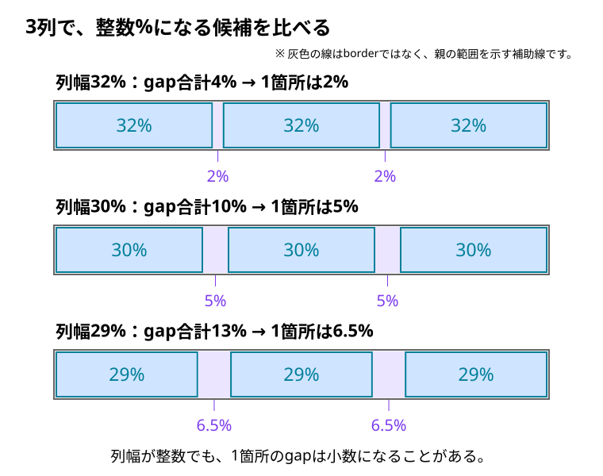

# 列幅とgapの一般式と整数パーセントの条件

[Figmaのカンプからcolumn-gapの割合を決める](../../../../02_基礎/12_Figma/05_カンプからcolumn-gapの割合を決める.md)では、3列・2列を具体的に計算した。ここでは、**列数が変わっても使える式と、整数%にしたい場合の候補の絞り方**を整理する。

前半の一般式だけでも計算できる。後半の合同式は、「候補にどんな規則があるか」を短く表すためのもの。間隔を決めるために暗記する必要はない。

## 1. まず「列の合計＋間隔の合計」で考える

次の条件を満たす場合を考える。

- 親の内容幅を100%とし、同じ幅の列を横に並べる。
- 列間もすべて同じ幅にする。
- 列と列間だけで100%を使い切る。追加の外側余白や余った空間は含めない。
- 列数は2以上とする。ここで数えるのは、横に並ぶ列の本数。

列が3本なら間は2箇所、4本なら間は3箇所になる。両端の外側はgapとして数えない。

```text
列幅 × 列数 ＋ 1箇所のgap × 間隔の数 ＝ 100%
間隔の数 ＝ 列数 − 1
```

これは、等幅の列と間隔の配分を確認する式。Gridでも、Flexで一行に等幅の子を並べる場合でも、同じ配分条件なら使える。ただしFlexのwidthがcontent-boxの幅で、別にpadding・border・marginが加わる場合や、子が伸縮して指定幅と異なる場合は、そのwidthを列幅として単純に代入しない。

## 2. 列幅からgapを求める一般式

列数を `n`、一列の幅を `w`、1箇所のgapを `g` と書く。ここで `w` と `g` は、**32%なら32、2%なら2という、%の数値部分**を表す。

```text
n × w ＋ (n − 1) × g ＝ 100
```

列が使う幅を100から引けば、gap全体に使える幅が分かる。それを間隔の数で割る。

```text
gap合計 ＝ 100 − n × w

1箇所のgap：
g ＝ (100 − n × w) ÷ (n − 1)
```

たとえば4列で一列を22%にするなら、次のようになる。

```text
列が使う幅：4 × 22 ＝ 88
gap合計　 ：100 − 88 ＝ 12
間隔の数　：4 − 1 ＝ 3
1箇所のgap：12 ÷ 3 ＝ 4%
```

**gap合計と、CSSへ書く1箇所のgapを分ける。** この例の `column-gap` は12%ではなく4%。

## 3. gapから列幅を求めることもできる

逆にgapが先に決まっているなら、gap全体を100から引き、残りを列数で割る。

```text
w ＝ {100 − (n − 1) × g} ÷ n
```

3列・gap 2%なら、

```text
w ＝ (100 − 2 × 2) ÷ 3
  ＝ 96 ÷ 3
  ＝ 32%
```

2列へ切り替えてgapを2%のままにするなら、

```text
w ＝ (100 − 1 × 2) ÷ 2
  ＝ 98 ÷ 2
  ＝ 49%
```

列数が変わると間隔の数も変わるため、同じgapでも一列の幅は変わる。Gridで `repeat(n, minmax(0, 1fr))` を使う場合、この配分はブラウザが行う。カンプから必要な値を選ぶ判断と、CSSによる幅の配分は分けて考える。

### 式を使える範囲

幅を持つ列を並べ、負でないgapにするなら、`w > 0`、`g ≥ 0` を満たす候補を選ぶ。列数が2以上の場合、`g < 100 ÷ (n − 1)` も必要になる。gapだけで100%を使い切る値では、列へ配る幅が残らない。

1列では列間がないため、この式を使ってgapを逆算しない。特に `n − 1` で割る式へ1を入れると、0で割ることになる。

## 4. 列幅を整数%にすると、残り方に規則がある

まず、合同式の記号を使わずに3列を比べてみる。

| 一列の幅 | 3列が使う幅 | gap合計 | 1箇所のgap |
| --- | --- | --- | --- |
| 32% | 96% | 4% | 2% |
| 30% | 90% | 10% | 5% |
| 29% | 87% | 13% | 6.5% |

列幅を整数%にすると、3列が使う幅は3の倍数になる。100は3で割ると1余るので、そこから3の倍数を引いた**gap合計も、3で割ると1余る数**になる。



図の最後は、列幅が整数でもgapは小数になる例。**列幅を整数にする条件と、gapも整数にする条件は違う。**

ここで、gap合計の数値を `G` と書く。

```text
G ＝ 100 − n × w
```

`w` が整数なら `n × w` は `n` の倍数なので、100とGをnで割った余りは同じになる。この「余りが同じ」という関係を**合同式**で書くと、次の形になる。

```text
G ≡ 100 (mod n)
```

`≡` は、この式では「nで割った余りが同じ」という意味。`mod n` は「nで割った余りに注目する」と読めばよい。

| 列数 | 列幅が整数%のときのgap合計 |
| --- | --- |
| 2列 | 2の倍数 |
| 3列 | 3で割ると1余る数 |
| 4列 | 4の倍数 |

これは候補の規則であり、デザインに合う値を一つに決めるものではない。列幅が正でgapが非負になる範囲も併せて確認する。

## 5. gapも整数%にしたいなら、もう一つ条件がある

3列で、列幅とgapの両方を整数%にしたいとする。先ほどの候補ではgap 2%・5%は該当し、6.5%は該当しない。

両方を整数にする条件は、もとの式から求められる。

```text
n × w ＋ (n − 1) × g ＝ 100
```

nで割った余りに注目する。

- `n × w` はnの倍数なので、余りは0。
- `(n − 1) × g` は `n × g − g` と書ける。
- gも整数なら `n × g` もnの倍数なので、残る条件は `−g` と100の余りが同じ、という関係になる。

```text
−g ≡ 100 (mod n)
 g ≡ −100 (mod n)
```

負の数の式のまま覚えなくても、列数ごとの候補で確認できる。

| 列数 | 列幅とgapを両方整数%にできる、1箇所のgapの規則 | 正のgapの候補例 |
| --- | --- | --- |
| 2列 | 2の倍数 | 2%、4%、6%、… |
| 3列 | 3で割ると2余る数 | 2%、5%、8%、… |
| 4列 | 4の倍数 | 4%、8%、12%、… |

たとえば3列・gap 5%なら、列幅は `(100 − 2 × 5) ÷ 3 ＝ 30%`。両方を整数にできる。

この表は**1箇所のgap**の規則。前の節の**gap合計**の表と混同しない。

## 6. 整数になることを、デザインより優先しない

29%の3列と6.5%のgapでも、`29 × 3 ＋ 6.5 × 2 ＝ 100`で整合する。小数%を使うこと自体に問題はなく、列幅・gapの両方を整数にそろえる義務はない。

合同式から分かるのは、指定した条件を満たす候補。著者がその値を選んだ理由や、カンプへの適合まで証明するものではない。候補を見つけたら、[Figmaの記事の表示確認](../../../../02_基礎/12_Figma/05_カンプからcolumn-gapの割合を決める.md#6-カンプの幅とその間の幅で確認する)へ戻り、カンプと中間幅で確かめる。

## このページのまとめ

- 列と間隔だけで親の内容幅を使い切るなら、`n × w ＋ (n − 1) × g ＝ 100`。
- 列幅からgap、gapから列幅のどちらも求められる。
- 列幅が整数なら、gap合計は `G ≡ 100 (mod n)` を満たす。
- gapも整数なら、1箇所のgapは `g ≡ −100 (mod n)` を満たす。
- 合同式は候補を絞る道具。一般式で具体的に計算するだけでもよく、デザインの判断や著者の意図とは分ける。
